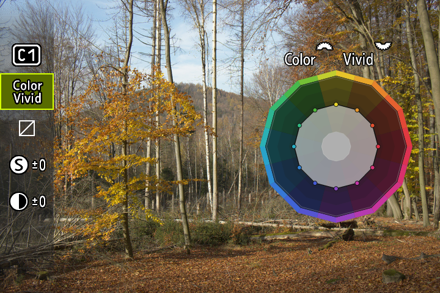
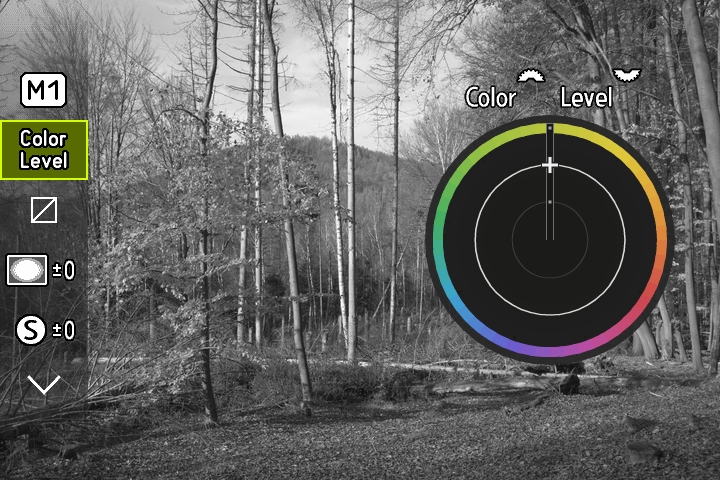
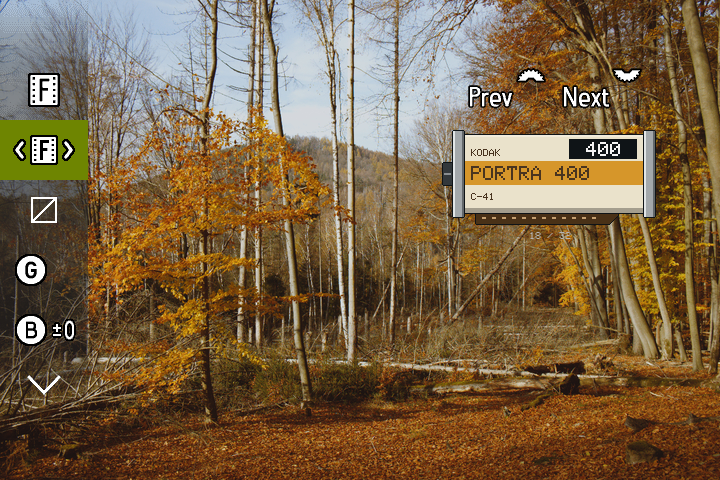

# OMKit

**OMKit** is a platform for exploring the firmware of OM System cameras and a modular custom extension for them. The
camera is flashed once, with a small loader patch; from then on everything lives on the SD card: the OMKit core, the
modules you choose, their updates and all their settings. Adding, updating or removing a module is a matter of copying
files to the card, and since nothing of OMKit is kept in the camera, going back to the stock behaviour is simple.

> [!NOTE]
> This repository and its releases contain **no firmware images** - neither the manufacturer's original firmware nor a
> patched one. You make the patched file yourself, on your own computer, with the firmware tool of a release: it takes
> the official firmware from the manufacturer's update server (or a copy you already have), accepts it only if its
> SHA-256 is that of the official file, and applies OMKit's loader patch to it ([Install](#install)).

## Supported cameras and firmware

| Camera | Firmware | Status | Install guide |
|---|---|---|---|
| OM SYSTEM OM-5 Mark II | 1.1 | supported | [install.md](docs/platform/om5m2/fw1100/install.md) |

## Modules and features

### Creative profiles (CREATPRF)

|  |  |
|---|---|
| Color Profile 1, the Color/Vivid editor | Mono Profile 1, the Color/Level editor |

- Three **colour profiles** and three **monochrome profiles** in the picture mode strip, with their own icons in every
  place the camera shows a picture mode.
- Edited on the camera in its own editor column: Color/Vivid (the saturation of 12 hue sectors), the tone curve
  (highlights, mid tones, shadows), sharpness and contrast; for monochrome the colour filter and its level, shading,
  grain and toning. The graphic editors are drawn by OMKit over live view.
- Applied to stills, live view and video recorded from the still modes.
- Import of ready-made community profiles (JPEG files): OM Workspace loads a colour or monochrome profile into the
  camera over USB ([details](docs/modules/creatprf/README.md#24-loading-profiles-from-a-computer)).

Details: [docs/modules/creatprf/README.md](docs/modules/creatprf/README.md).

### Film look (FILMLOOK)

|  |
|---|
| The film look's column over live view: its preset under the cursor (between the arrows), with the preset's cassette and number drawn beside it, then the tone curve, Grain (G) and Bloom (B, at the preset's ±0); Halation (H) is on the column's next page |

- A **film look** in the place of one stock picture mode (i-Enhance by default): the dials step through **presets** -
  `.ISP` files on the card, each a set of the camera's own colour tables - and live view and the pictures take the chosen
  one at once. Every preset shows its own cassette picture.
- **32 bundled presets**, from Kodak Portra, Ektar, Kodachrome and Tri-X to Fujifilm and Ilford stocks, cinema films
  and a few looks of their own ([the list](docs/modules/filmlook/presets.md)). The set is yours to change: add your own
  presets by copying `.ISP` files to the card, and delete the bundled ones you do not want.
- A **tone curve** editor per preset, kept across power-offs.
- **Film grain** on the stills: 11 grain tiles in four strengths (Off, Low, Med, High), weaker in the shadows and
  highlights as on film ([the tiles](docs/modules/filmlook/grain.md)).
- **Bloom and Halation** on the stills, strength 0-5 per preset: the glow of a diffusion filter, and the red-orange halo
  around lamps of a film without an anti-halation layer ([how they work and their limits](docs/modules/filmlook/optics.md)).

Details: [docs/modules/filmlook/README.md](docs/modules/filmlook/README.md).

Writing your own module: [docs/modules.md](docs/modules.md) and the [SDK](docs/sdk.md); the example module HELLO:
[docs/modules/hello/README.md](docs/modules/hello/README.md).

## Disclaimer

> [!WARNING]
> **Use at your own risk.** OMKit works through an unofficial patch to the camera's firmware. It is provided "as is",
> without any warranty. It can **make the camera misbehave, freeze or stop starting, can cause data loss** and **may
> affect the manufacturer's warranty**. **Nobody involved in OMKit accepts liability for any damage.** Read the install
> guide of your camera (for the OM-5 Mark II on firmware 1.1: [install.md](docs/platform/om5m2/fw1100/install.md)),
> including how to go back to the official firmware, before you install anything.

## Install

In short, for a supported camera and firmware:

1. Check that the camera runs **exactly** the supported firmware version (flashing over another version can brick the
   camera), and charge its battery.
2. Download the OMKit release ZIP for your camera and firmware ([releases](https://github.com/necrostaz/omkit/releases)), and extract it.
3. **Already installed OMKit before** (and no official firmware since)? The camera keeps its loader patch: skip the firmware tool and the flashing, just
   update the `OMKIT` folder on the card from the new release (keep your own `OMKIT.INI` to keep your settings) - and
   you are done.
4. Run the release's firmware tool (a double-click launcher for Windows and macOS, a shell script for Linux; it needs Python). The tool
   downloads the official firmware from the manufacturer, checks it, applies OMKit's loader patch on your computer and
   checks the result. OMKit itself never contains or distributes firmware.
5. Update the camera from the card with the patched file - the camera's own update from the card, with OK held at
   power-on. This is the only time the camera is flashed. Then switch it on again and check that it starts normally.
6. Copy the `OMKIT` folder of the release to the card. Its modules are already on, with their default settings.

Going back: install the official firmware the same way (the tool keeps a copy for it), and use a card without `OMKIT`.
Taking the card out, or holding OK at power-on (with no firmware update file on the card), starts the camera without
OMKit at any time.

The full guide, with what to expect and troubleshooting:
[install.md for the OM-5 Mark II, firmware 1.1](docs/platform/om5m2/fw1100/install.md).

## Create and test your own film presets

Three programs for the computer make and check `.ISP` presets for FILMLOOK. They run locally (Python 3.10+; numpy,
Pillow, rawpy; PyTorch is optional and only makes them faster) - [docs/apps/README.md](docs/apps/README.md):

- **[ISP player](docs/apps/isp_player.md)** - drop a picture (the camera's RAW, or a JPEG, PNG, TIFF) and an `.isp`
  preset into a local web page and see the picture through the preset as the camera's colour path renders it, with the
  preset's cassette and tables.
- **[ISP fitter](docs/apps/isp_fitter.md)** - fits a `.cube` look (a 3D LUT) to the camera's colour tables and saves it
  as an `.isp` preset with its name and cassette; shows the look, its copy through the camera's tables and the accuracy.
- **[ISP neurofit](docs/apps/isp_neurofit.md)** - makes a preset from two unpaired picture sets, the camera's RAW files
  and scans of one film stock; a command line tool driven by an AI agent through a portable agent skill, which judges
  the results by eye.

## Trademarks

OMKit is an independent project, not affiliated with, endorsed by or sponsored by OM Digital Solutions Corporation.
"OM SYSTEM", "OM-5 Mark II" and "Olympus" are trademarks of their owners and are used only to name the camera OMKit runs
on.

The bundled FILMLOOK presets carry film names (Kodak Portra, Ektar, Kodachrome, Tri-X, Vision3, Fujifilm Superia,
Eterna, Ilford HP5 and others). They describe the character of the look a preset imitates with the camera's own colour
tables; they are not the manufacturers' products, and their use implies no connection with or approval by the
trademark owners.

## License

OMKit is licensed in two parts (details in [NOTICE](NOTICE)):

| What | License |
|---|---|
| Software: `src/`, `tools/`, `apps/` (code, pages, the agent skill), `release/`, `tests/`, `toolchain/`, build files | [Apache License 2.0](LICENSE) |
| Documentation and data: `docs/`, `resources/` (module pictures, grain tiles, presets), `apps/ispkit/data/` (the colour prior) | [CC BY 4.0](LICENSE-CC-BY-4.0) |

What you make with OMKit is yours: your own `.isp` presets, grain tiles, priors and modules are not covered by OMKit's
licenses. Modules built with the SDK (`src/sdk/`, linked into each module) may use any license their authors choose.

Contributions are accepted under the same licenses (Apache-2.0 section 5; CC BY 4.0 for docs and data).

## Credits

Many thanks to the authors of these projects. Their research, the information they published and their ideas helped
OMKit a great deal.

- [om-emu](https://github.com/flatpanda/om-emu) - an emulator of OM System and Olympus camera firmware.
- [caduceus-om3](https://github.com/androidfanman/caduceus-om3) - in-camera colour editing and firmware modifications
  for an OM System camera.
- [olympus-firmware-notes](https://github.com/nsud-dev/olympus-firmware-notes) - notes on the firmware of Olympus
  cameras.
- [oly_fw_analysis](https://github.com/fishcu/oly_fw_analysis) - an analysis of Olympus camera firmware.
