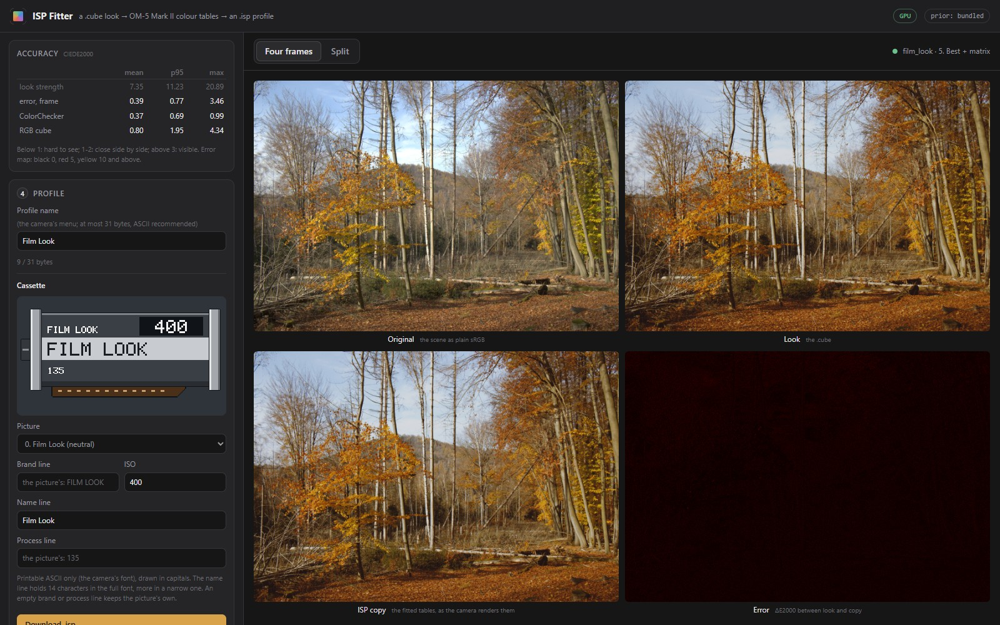
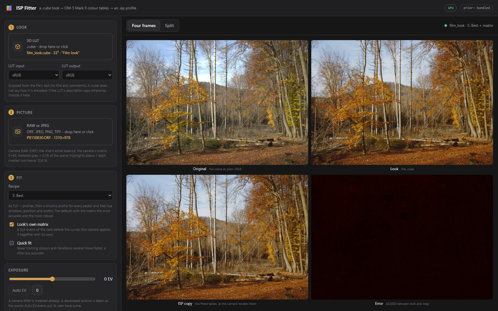

# ISP fitter



<details><summary>The inputs: the look, its encodings, the picture and the recipe</summary>



</details>

The ISP fitter turns a **look** - a 3D LUT in a `.cube` file - into an **`.isp` profile** for the OM-5 Mark II: it fits
the camera's own colour tables (matrix, gamma curves, saturation, tone curve, 12 hue sectors) so that the camera renders
the look as closely as its colour path allows. A local web page shows the look, its copy through the camera's tables
and the difference between them on a picture of your choice, lets you set up the cassette picture the camera shows for
the preset, and saves the `.isp` file for the [FILMLOOK module](../modules/filmlook/README.md).

Code: `OMKit/apps/isp_fitter/` (the server, the page, `build_prior.py`) on top of the shared library
`OMKit/apps/ispkit/` (the fit itself: `cube.py`, `train.py`, `fit.py`, `prior.py`; the model of the colour path:
`model.py`, `camera.py`).

Contents: [1. Install](#1-install) · [2. Start](#2-start) · [3. Using the page](#3-using-the-page) ·
[4. The cassette and the profile's name](#4-the-cassette-and-the-profiles-name) ·
[5. Saving and using the profile](#5-saving-and-using-the-profile) · [6. Which .cube files fit](#6-which-cube-files-fit) ·
[7. The fitting model](#7-the-fitting-model) · [8. The photo colour prior: how the weights were obtained](#8-the-photo-colour-prior-how-the-weights-were-obtained) ·
[9. Privacy and the fit cache](#9-privacy-and-the-fit-cache) · [10. Limits](#10-limits) · [11. Troubleshooting](#11-troubleshooting)

## 1. Install

1. Python 3.10 or newer (`python --version`).
2. From the folder that holds `OMKit/`:

   ```sh
   python -m pip install -r OMKit/apps/requirements.txt
   ```

   Best in a virtual environment: [apps/README.md, Install once](README.md#install-once) shows it for Windows,
   Linux and macOS.

   This installs numpy, Pillow and rawpy (rawpy only for the camera's RAW files, `.ORF`, used as the preview picture).
3. Optional, recommended: PyTorch with CUDA (an NVIDIA GPU). Install the build for your CUDA version as the PyTorch site
   describes. The fit's heavy part (the Jacobian and the normal equations) then runs on the GPU in float32, the frames
   are rendered there too; without it everything runs on the CPU with numpy. The top bar of the page says which is
   used (`GPU` or `CPU`).

Fit times measured on a desktop (12-core CPU, a current NVIDIA GPU) with 33^3 film looks, default options:

| Recipe | GPU | CPU (numpy) | Quick fit, GPU | Quick fit, CPU |
|---|---|---|---|---|
| 1. Curves, 2. Curves + saturation | under 1 s | under 1 s | under 1 s | under 1 s |
| 3. Full | 1-2 s | 4-10 s | under 1 s | 2 s |
| 5. Best (default) | 4-5 s | 25-35 s | 2 s | 6-8 s |
| 6. Best + all | 3-15 s | 40-110 s | 3-4 s | 8-11 s |

A black-and-white look takes under a second with any recipe (section 7.4). A fit is done once per look and options: it
is kept and opens at once the next time (section 9).

## 2. Start

```sh
python OMKit/apps/isp_fitter/run.py
```

It prints the address, `http://127.0.0.1:8791/` - open it in a browser. Options:

| Option | Meaning |
|---|---|
| `--port N` | another port (default 8791; `0` picks any free one) |
| `--open` | open the page in the default browser |
| `--prior FILE.npz` | fit with your own photo colour prior (section 8.5) instead of the bundled one |
| `--cache DIR` | keep fits in this folder (default: the user's cache folder, section 9) |
| `--no-cache` | keep fits in memory only |

Ctrl+C in the terminal stops it. The same from inside `OMKit/apps`: `python -m isp_fitter [options]`.

Environment variables, for special cases: `ISPKIT_GPU=0` fits and renders on the CPU even with a GPU; `ISPKIT_THREADS=N`
sets the number of CPU render threads (default up to 4).

## 3. Using the page

1. **Look.** Drop a `.cube` file on the "Look" box, or click it and choose one. To try the fitter without a look of
   your own: `OMKit/docs/apps/samples/film_look.cube`, a 17-point look computed from the bundled preset Kodak Portra 400
   (sRGB in, sRGB out). Files can also be dropped anywhere on
   the page: a `.cube` file becomes the look, anything else the picture. The fit starts at once.
2. **LUT input and output.** A `.cube` file does not say how its input and output are encoded. The fitter guesses it
   from the file's title and comments (section 6) and shows the guess in the two lists under the box; if the LUT's
   description says otherwise, choose the right ones - the look is fitted again.
3. **Picture.** Drop or choose a picture: the camera's RAW (`.ORF`, the closest preview) or a JPEG, PNG, TIFF. The
   picture only shows the result: the fit does not depend on it. Under the box: the colour space found and how; for a
   developed picture the **Colour space** list overrides it.
4. **Fit.** The **Recipe** list chooses what the fit may change (section 7.2); its description is shown under it.
   **Look's own matrix** adds a 3x3 matrix of the look before the curves (section 7.3; on by default). **Quick fit**
   uses fewer training colours and iterations: several times faster, a little less accurate - good for trying looks,
   the normal fit for the profile you keep. Any change fits again. While a fit runs, a bar shows its progress (the
   stage and the iteration of the optimiser); with a new look or option the page stops waiting for the old fit (which
   still finishes on the server and is kept).
5. **Black and white.** When the look has no colour of its own, a note says so ("black-and-white look" or "toned
   black-and-white look") - it is then fitted in one stage whatever the recipe (section 7.4).
6. **Exposure.** The slider changes the exposure from -3 to +3 EV in quarter steps before the tables, as the camera's
   exposure would. **Auto EV** chooses the exposure at which the look is as bright as the picture itself (the mean CIE
   L*): a developed picture already carries a tone curve, and a film look adds its own. For a camera RAW it is off -
   the RAW is metered already. **0** resets.
7. **The views.** *Four frames*: the original (the scene as plain sRGB), the look (the `.cube` itself), the ISP copy
   (the fitted tables as the camera renders them) and the error map (CIEDE2000 between the look and the copy: black 0,
   red 5, yellow 10 and above). *Split*: two of them side by side under one moving divider - choose the pair (look |
   ISP, original | ISP, original | look); drag on the frame, use the arrow keys (Shift: steps of 10 %), double-click
   to centre.
8. **Accuracy** (CIEDE2000; mean, 95th percentile, maximum):

   | Row | What it compares |
   |---|---|
   | look strength | the look against the original on this picture: how strong the look is (not an error) |
   | error, frame | the ISP copy against the look, over the pixels of this picture |
   | ColorChecker | the ISP copy against the look on the 24 patches of a ColorChecker chart, metered exposure |
   | RGB cube | the ISP copy against the look on 17 x 17 x 17 colours spanning the whole sRGB cube, its most saturated corners included |

   As a rough guide: below 1 the difference is hard to see, 1-2 is close side by side, above 3 it is visible. The
   frame's error is the most telling number for your kind of pictures; ColorChecker covers everyday colours; the cube's
   maximum sits at extreme saturated colours that photographs rarely hold. Typical values: section 7.6.
9. **Profile**: the name and the cassette (section 4), then **Download .isp** (section 5).

## 4. The cassette and the profile's name

FILMLOOK shows a picture of a film cassette for the chosen preset, with its number under it. The fitter draws one of
the kit's 30 generic pictures with your texts on it and stores it in the file (the `CANI` section,
[formats/isp.md section 5a](../formats/isp.md#5a-cani-the-cassette-picture)). The preview is the cassette as the
camera draws it.

| Field | What it is | Limits |
|---|---|---|
| Profile name | the preset's name in the file's header; FILMLOOK shows it where a name is shown | at most 31 bytes of UTF-8; ASCII is recommended (the camera's font may lack other characters); not empty |
| Picture | one of the 30 generic pictures: 6 with a line of their kind (neutral, yellow, green, black-and-white, slide, motion picture), 19 film pictures without text of their own, 5 instant packs, cartridges and an old-process cassette | - |
| Brand line | the top row, left of the ISO window | printable ASCII; must fit the row (an error says so); the file's header keeps 15 characters |
| ISO | the number in the ISO window | printable ASCII, at most 7 characters |
| Name line | the middle row, the film's name | printable ASCII; 14 characters in the full font, longer names in a narrow font, then cut (a warning says what is drawn); the header keeps 23 characters |
| Process line | the bottom row (for example `C-41`, `E-6`) | printable ASCII; must fit the row |

Everything is drawn in capitals, in the camera's own 5 x 8 pixel font. An empty brand or process line keeps the
picture's own line (shown as the field's placeholder; the film pictures have none). Defaults when a look is loaded:
the picture is chosen by words in the look's file name (a known film maker or kind: black and white, slide, motion
picture, instant), the ISO is the last 2-4 digit number in the name, the name line follows the profile's name until
you edit it. Errors (shown in red) block the download; warnings (yellow) do not.

## 5. Saving and using the profile

**Download .isp** saves the profile through the browser (its usual download folder). The file name comes from the
profile's name: ASCII letters, digits, `-` and `_`, at most 35 characters, then `.isp`. The file holds:

- `ISPB` - the fitted tables, base mode Natural ([formats/isp.md section 5](../formats/isp.md#5-ispb-for-the-platform-om5m2));
- `META` - provenance lines: `fitter` (the fitter's version), `variant` (the recipe), `matrix`, `domain` (`lin`), `art`
  (the generic picture's number); the camera does not read them;
- `CANI` - the cassette picture.

Copy the file to the memory card's `OMKIT\FILMLOOK\` folder, next to the other presets: FILMLOOK lists the presets in
the order of their file names ([modules/filmlook/README.md](../modules/filmlook/README.md),
[presets.md](../modules/filmlook/presets.md#5-installing-the-set)). To look at the file again later - the frame
through it and everything it holds - open it in the [ISP player](isp_player.md).

## 6. Which .cube files fit

The fitter reads the `.cube` text format: `LUT_3D_SIZE` (2 to 129), the table with red changing fastest,
`DOMAIN_MIN` / `DOMAIN_MAX` or `LUT_3D_INPUT_RANGE` (honoured), `TITLE` and `#` comments (read for the guess); the
lookup is trilinear. What it needs to know besides the table is how the scene enters the LUT and how its output is
meant to be shown:

| LUT input | Meaning | Guessed when the file's text has |
|---|---|---|
| sRGB | the sRGB curve on BT.709 primaries, scene clipped at 1: a look made for developed pictures ("display-referred") | (the default) |
| Cineon log | Cineon printing density (black 95, white 685 of 1023, 300 codes per decade) on BT.709 primaries: film print looks for log footage | `cineon` |
| linear | linear light 0..1, BT.709 primaries | (choose by hand) |
| ACEScct curve, BT.709 primaries | the ACEScct log curve, but on BT.709 primaries | `acescct` |

| LUT output | Meaning | Guessed when |
|---|---|---|
| sRGB | an sRGB display | (the default) |
| Rec.709 gamma 2.4 | a Rec.709 / BT.1886 display (gamma 2.4) | the input is Cineon and the text has `2.4`, `rec709` or `rec.709` |
| gamma 2.2 | a display of gamma 2.2 | (choose by hand) |

**Fits:** 3D LUTs with any of these inputs and outputs - photo looks made in sRGB, film scan emulations, film print
looks for Cineon log with a Rec.709 output, linear-light looks on BT.709 primaries.

**Does not fit** (the fit runs, but on the wrong colours, or the file is refused):

| Kind of file | What happens |
|---|---|
| 1D LUT (`LUT_1D_SIZE` only) | refused: only 3D LUTs are read |
| a 1D shaper and a 3D table in one file | refused |
| a camera maker's log curve with its own wide gamut as the input | no matching input: choosing another one fits the wrong colours |
| ACEScct, ACEScc or ACEScg on the ACES primaries (AP1, AP0) | only the ACEScct *curve* on BT.709 primaries is known: colours come out shifted |
| Rec.2020, P3 / DCI-P3 or other wide-gamut primaries, input or output | not known: colours come out shifted (wrong saturation and hue) |
| HDR outputs (PQ, HLG) | not known |
| LUTs that expect scene values above 1 (a linear LUT with a domain up to 16, say) | the scene is clipped at 1 before the LUT: highlights above the diffuse white become white |
| other LUT formats (`.3dl`, `.csp`, ...) | not read: convert them to `.cube` first |

Whatever the file, the camera can only copy what its colour path can do (section 7.1): a look that turns one hue
differently in shadows and highlights, or swaps colours in a narrow range, is copied in part - the error map shows
where.

## 7. The fitting model

### 7.1. What the camera's colour path offers

The camera renders a JPEG from the white-balanced RAW in fixed stages; a profile replaces the tables of some of them
(details: [platform/om5m2/color-pipeline.md](../platform/om5m2/color-pipeline.md), the file's tables:
[formats/isp.md section 5](../formats/isp.md#5-ispb-for-the-platform-om5m2)):

1. the camera's own 3x3 matrix for the light of the frame (kept) - and, if the profile has one, **the look's matrix F**
   applied together with it ([3.1](../platform/om5m2/color-pipeline.md#31-white-balance-and-the-matrix));
2. **three gamma curves**, R, G and B, of 256 nodes each, on the linear signal
   ([3.2](../platform/om5m2/color-pipeline.md#32-gamma-r-g-b));
3. YCbCr, with **the saturation factor k** on Cb and Cr ([3.3](../platform/om5m2/color-pipeline.md#33-ycbcr-and-the-saturation-k));
4. **the tone curve** on luma Y only ([3.4](../platform/om5m2/color-pipeline.md#34-tone-on-y));
5. **12 hue sectors**: each adds to the chroma, turns the hue and adds to the luma of the colours inside its hue,
   chroma and luma windows, weighted by profiles over each window
   ([3.5](../platform/om5m2/color-pipeline.md#35-the-12-hue-sectors)).

The fitter works with a numerical model of these stages (`ispkit/model.py`), the same one the
[ISP player](isp_player.md) renders with. A look is defined on the scene (linear light, middle grey at 0.18); the
model's input is what the camera's tables receive: the camera meters middle grey to 0.075 of the sensor's white, so the
scene reaches the look scaled by 0.18 / 0.075, and the camera's highlights above the scene's 1 (up to 2.4 times it, the
sensor's white) render as the look's white.

### 7.2. The recipes: what each stage fits

The fit varies the model's continuous parameters and finally rounds them to the camera's table formats. The global
part: gamma curves of 33 knots per channel (99 values, interpolated to the 256 nodes), a tone curve of 17 knots, k, and
- with the matrix option - the matrix's 6 off-diagonal values (each row sums to 1, so grey stays grey). A recipe runs
in stages; each stage starts from the previous one's result, and the global part stays free in every stage:

| Recipe | Stage 1 | Stage 2 | Stage 3 | Parameters in the last stage (with the matrix) |
|---|---|---|---|---|
| 1. Curves | gamma, tone (+ matrix); k = 1, no sectors | - | - | 122 |
| 2. Curves + saturation | gamma, tone, k (+ matrix) | - | - | 123 |
| 3. Full | global part | + the 36 sector additions (3 per sector) with the camera's own windows and profiles | - | 159 |
| 4. Full + profiles | global part | + additions, + one chroma profile per operation shared by all sectors | - | 204 |
| 5. Best (default) | global part | as stage 2 of Full + profiles | + a chroma profile per sector and operation, + every sector's hue window (centre and width) | 723 |
| 6. Best + all | global part | as stage 2 of Full + profiles | as Best, + a hue profile per sector and operation, + a luma profile per sector, + chroma and luma windows | 1503 |

Every recipe but "Curves" starts with the global part alone, so the sectors only take what the curves and k leave.
A safeguard: a "Curves" stage is also fitted from the same start; when the first stage ends far above it (stuck, as
with a look that swaps colour channels), the stages are run again from the curves' result and the better result kept.

More parameters are not always better: "Best + all" can follow the training colours more closely but often generalises
worse, especially with the matrix (section 7.6). "Best" is the default for that reason.

### 7.3. The matrix option

With **Look's own matrix** the profile carries a 3x3 matrix F; the camera multiplies its own matrix by it, so F acts on
the camera's linear signal before the gamma curves - like a change of the film's colour sensitivities. It moves colours
in ways the curves and sectors cannot (a hue rotation across all saturations, a channel mix) and halves the error of
black-and-white looks. With F the white balance and the camera's own adaptation to the light stay. Off, the file marks
no matrix and the camera keeps its own.

### 7.4. Black-and-white looks

Before fitting, the look is run on the training colours. When its a* and b* depend on L* alone (within 1.0 of their
mean at the same L*, 99th percentile), the look is black and white: **neutral** when its chroma stays below 0.25 too,
else **toned** (a tinted print). Such a look is fitted in one stage, whatever the recipe:

- the tone curve is held at the identity;
- with the matrix, its three rows are held equal: one weighted sum of R, G and B, like a black-and-white film's
  spectral sensitivity (without the matrix the camera's fixed luma weights are used);
- neutral: k = 0 (no colour at all) and one gamma curve for all three channels;
- toned: k = 1, the tint comes from the differences between the R, G and B gamma curves; no sectors.

FILMLOOK recognises such a profile as black and white (no colour grain).

### 7.5. The cost and the optimiser

**The training set** - the colours the fit is made on, in the camera's table signal (`ispkit/train.py`):

| Part | Points (normal / quick) | Weight | Why |
|---|---|---|---|
| the neutral axis: black, then 2^-12 of full scale to full scale | 64 | 200 each, 12 800 in all | carries the look's tone curve and exposure exactly |
| ColorChecker's 24 patches at exposures -4 to +3 stops around the metered one (those inside the signal's range) | 165 | 4 each, 660 in all | everyday colours over the whole tonal range |
| the RGB cube of the signal | 13^3 = 2197 / 9^3 = 729 | 1 at grey down to 1/2 at chroma 35 (C*ab): 720 / 232 in all | every colour the camera can deliver, saturated ones less |
| the photo colour prior (section 8) | 4141 / 1569 cells | 1000 in all | where real photographs' colours are, and how often |

**The cost** is the weighted sum over the training colours of the squared CIEDE2000 difference between what the look
gives and what the model gives (the CIEDE2000 metric linearised at the look's colour, so the difference is a weighted
Euclidean distance in CIELAB), plus regularisation terms that keep the solution physical: smooth, non-decreasing gamma
and tone curves; a tone curve near the identity in the deepest shadows and nowhere steeper than 2 (a steeper one would
amplify every rounding of the camera); k at most 1.5; small sector additions (the sectors only take what the global part
leaves); smooth profiles within the hardware's range.

**The optimiser** is Levenberg-Marquardt: the model's analytic Jacobian (the derivative of every training colour over
every parameter) gives the normal equations, solved for the step with an adaptive damping; a step is kept when it
lowers the cost. After each step every value is brought within what the hardware holds (sector additions within +-0.5
of chroma, +-100 degrees of hue, +-0.125 of luma; windows within their fields; profile values within -1 .. 63/64). A
stage stops after 40 iterations (12 in a quick fit) or when the cost improves by less than 0.01 %. The continuous result
is then rounded to the camera's formats: the matrix to Q7 with rows summing to 128, gamma to 12 bits, tone to 10 bits,
the sector records and profiles to their fields. The accuracy numbers and the frames are computed from these rounded
tables, as the camera would use them.

With a GPU, the Jacobian products run in float32; the normal equations are then solved on the CPU in float64. The
GPU's tables can differ from the CPU's in the last rounding, so the fit cache keeps them apart.

### 7.6. What the accuracy numbers mean, typical values

The numbers on the page are CIEDE2000 between the look and the ISP copy (section 3, step 8). Measured with the normal
fit on six film looks (33^3; ColorChecker mean / 95th percentile, RGB cube mean / maximum):

| Look | Curves | Full | Best | Best, no matrix | Best + all |
|---|---|---|---|---|---|
| colour negative scan (sRGB in and out) | 3.7 / 8.2, 4.9 / 17 | 1.6 / 3.8, 2.7 / 13 | 1.0 / 2.1, 2.1 / 13 | 1.1 / 2.2, 2.8 / 14 | 1.2 / 2.6, 2.1 / 13 |
| slide film (sRGB) | 3.5 / 7.8, 5.3 / 25 | 1.6 / 3.9, 2.8 / 13 | 0.9 / 1.7, 1.9 / 10 | 1.1 / 2.0, 2.6 / 19 | 1.1 / 1.9, 2.1 / 10 |
| saturated colour negative (sRGB) | 4.8 / 11, 5.8 / 20 | 2.2 / 5.0, 3.3 / 19 | 1.4 / 3.3, 2.8 / 18 | 1.7 / 4.1, 3.9 / 20 | 0.9 / 2.3, 2.4 / 15 |
| motion picture negative and print (sRGB) | 3.3 / 7.8, 4.7 / 21 | 1.5 / 3.5, 2.7 / 15 | 1.0 / 1.8, 1.8 / 14 | 1.0 / 1.7, 2.3 / 14 | 1.3 / 3.4, 2.2 / 14 |
| print film for log footage (Cineon in, Rec.709 out) | 3.5 / 8.6, 5.6 / 27 | 1.9 / 5.4, 3.4 / 21 | 0.8 / 1.4, 1.7 / 18 | 1.2 / 3.6, 3.3 / 25 | 1.1 / 1.5, 2.1 / 20 |
| black-and-white film (neutral) | 0.8 / 2.2, 1.7 / 6.8 | the same (one stage) | the same | 0.9 / 3.2, 3.3 / 16 | the same |

So: the curves alone leave 3-5 on ColorChecker; the sectors bring it to about 1 ("Best"), which is close to what the
model itself is worth on the camera (the camera's JPEGs differ from the model by a median CIEDE2000 of about 1.3 on real
scenes: [color-pipeline.md section 6](../platform/om5m2/color-pipeline.md#6-camera-against-the-model)). The cube's
maximum stays at 10-25: the most saturated corners of the sRGB cube, where the look and the camera's 12 sectors part
ways; photographs rarely hold such colours, and the prior weights them accordingly. A quick fit lands within about 0.3
of these ColorChecker means (sometimes below them: it is fitted on fewer colours). On real pictures - the 18 held-out
pictures of the prior's set (section 8.2), their pixels taken as metered scenes - "Best" with the matrix differs from
the look by a mean CIEDE2000 of 0.4 (black-and-white) to 1.1 (saturated colour negative), the 95th percentile 1.0 to
2.7.

## 8. The photo colour prior: how the weights were obtained

The synthetic part of the training set treats all colours alike; real pictures do not. The **photo colour prior** tells
the fit which colours photographs hold and how often, so the fit spends its accuracy where pictures need it (skin,
foliage, sky, neutrals) rather than on colours that hardly occur. It is colour statistics only: cell mean colours and
weights, no pictures. The bundled one is `OMKit/apps/ispkit/data/prior.npz` (format: section 8.4).

### 8.1. The pictures

The prior is built from the author's own pictures only: **58 camera JPEGs** (colour only), chosen from a year of everyday
shooting by clustering the pictures on per-scene colour features (k-means), then adding pictures of rare scene kinds and
checking them by eye. Scene categories of the 58 (a picture can have several): people 19, saturated colours 18, city 16,
sky 10, warm indoor light 10, overcast 8, foliage 8, landscape 7, deep shadows 6, night 6, golden hour 3, bright scenes
2, sunset 2, animal 1, sunny 1. They are one photographer's everyday scenes, so colours such scenes rarely hold get
little weight: strongly saturated blues, purples and greens hardly occur in them, and a fit follows the look a little
less closely there. If your pictures differ, build a prior of your own (section 8.5).

### 8.2. Train and test, downscaling, picture weights

- **Split by picture**: the 58 pictures were split into training pictures (40) and held-out pictures (18) used only to
  evaluate fits, the categories balanced between the two sides. The prior holds the **40 training pictures** (people
  13, saturated colours 12, city 11, sky 7, warm indoor light 7, foliage 5, overcast 5, landscape 5, deep shadows 4,
  night 4, golden hour 2, bright scenes 1, sunset 1); no pixel of a held-out picture is in it.
- **Downscaling**: every picture is converted to sRGB (by its ICC profile), turned by its EXIF orientation and shrunk to
  240 pixels on the long side (box filter): 1 536 000 pixels for the 40 training pictures. Only colour statistics
  matter here; the size keeps the work small.
- **Picture weights**: every pixel counts with its picture's weight; all 40 pictures have the weight 1.

### 8.3. The binning

The pixels of all training pictures are binned by their encoded sRGB value into 24 x 24 x 24 cells (16 x 16 x 16 for
the quick fit). Each occupied cell becomes one training colour: the **mean linear colour** of its pixels (weighted by
the picture weights); its weight is the cell's summed pixel weight **to the power 0.5** - frequent colours count more,
but a large uniform area does not drown the rest - and the weights are normalised to sum to 1. That gives 4141 cells
(24^3) and 1569 cells (16^3). In the training set the prior's colours are brought to the camera's signal as metered
scenes and its weights multiplied by **1000** - comparable to the RGB cube's total weight (720) and ColorChecker's
(660), a fifteenth of the whole set's; the neutral axis carries most of the rest (section 7.5).

### 8.4. The file

`prior.npz` is numpy's zip of arrays (read with `allow_pickle=False`), the values stored exactly as float64:

| Array | Shape | Content |
|---|---|---|
| `x24`, `w24` | (4141, 3), (4141,) | the 24^3 cells: mean linear BT.709 colour, weight (sums to 1) |
| `x16`, `w16` | (1569, 3), (1569,) | the same for the quick fit |
| `info` | text | JSON: format 1, the bins, the weight exponent 0.5, the long side 240, the number of pictures (40) and pixels, the set's size, a description |

### 8.5. Your own prior

A prior from your own pictures fits the look where your kind of pictures need it:

```sh
python OMKit/apps/isp_fitter/build_prior.py PHOTOS_DIR my_prior.npz [--recursive] [--description TEXT]
python OMKit/apps/isp_fitter/run.py --prior my_prior.npz
```

`build_prior.py` reads every JPEG, PNG and TIFF of the folder (with `--recursive` also of sub-folders), converts,
turns and shrinks them as in section 8.2 (every picture weight 1, no train/test split - all pictures
go in) and bins them as in section 8.3. Take a few dozen varied pictures of the scenes you shoot - a handful gives a
prior that describes only them. The file holds no pictures and no file names. The fit cache keeps fits made with
different priors apart; the top bar of the page shows which prior is in use.

## 9. Privacy and the fit cache

Everything stays on the computer. The server listens only on 127.0.0.1, so no other machine can reach it; the page loads
nothing from the internet. Looks and pictures are kept in memory only (the last 16 looks and 4 pictures) and are gone
when the fitter stops.

Fits are kept in memory and in a cache folder, one small JSON file per fit with the fitted tables and the accuracy
numbers - nothing of the look's table and nothing of any picture. A fit is found again by the look's content (its
SHA-256), the input and output encodings, the recipe, the matrix and quick options, the fitter's version, the prior and
whether it ran on the GPU or the CPU: changing any of them fits again. The default folder is the user's cache folder:

| System | Folder |
|---|---|
| Windows | `%LOCALAPPDATA%\OMKit\isp_fitter\fits` |
| macOS | `~/Library/Caches/OMKit/isp_fitter/fits` |
| Linux and others | `$XDG_CACHE_HOME/OMKit/isp_fitter/fits` (else `~/.cache/OMKit/isp_fitter/fits`) |

`--cache DIR` puts it elsewhere, `--no-cache` keeps fits in memory only; deleting the folder is always safe.

## 10. Limits

| What | Limit |
|---|---|
| `.cube` upload | 64 MB; `LUT_3D_SIZE` 2..129 |
| picture upload | 200 MB; Pillow's own guard refuses pictures of more than about 179 megapixels |
| shown size | at most 1400 pixels on the long side (a whole step, not resampled) |
| RAW files | `.ORF` of the OM-5 Mark II (the camera model: white balance, matrix, metering) |
| fits | one at a time; a fit asked for while another runs waits for it |
| profile name | 31 bytes of UTF-8 |
| exposure | -3..+3 EV in quarter steps |

What the frames do not show: the camera's other picture settings (sharpness, noise filter, contrast, highlight and
shadow control, lens corrections), the FILMLOOK edits made on the camera, film grain, noise and JPEG compression - the
frames are the colour path only, as in the [ISP player](isp_player.md#5-what-the-render-is-and-what-it-is-not).

## 11. Troubleshooting

| Symptom | What to do |
|---|---|
| "cannot listen on 127.0.0.1:8791" | another program (or a second fitter) uses the port: start with `--port 8792` or `--port 0` |
| "a 1D LUT (or a 1D shaper before the 3D table)" | only plain 3D LUTs are supported (section 6) |
| "not a 3D .cube: size N, M rows" | the file is damaged or not in the `.cube` text format |
| the look on the page looks wrong (too flat, too contrasty, colours off) | the LUT input or output is not the one the LUT was made for: try the other choices in the two lists (section 6) |
| large error in highlights | the look expects scene values above 1, or the picture is a developed one whose highlights are clipped; try a camera RAW, or Auto EV |
| large error on a few saturated colours | the camera's 12 sectors cannot follow the look there; try "Best + all" or switch the matrix off and compare the frame's error |
| "the fit is not on the server" / "the look is not on the server" | the fitter was restarted or the look dropped out of memory: drop the `.cube` again (a cached fit opens at once) |
| "reading camera RAW files needs the rawpy package" | `python -m pip install rawpy` |
| the cassette shows an error in red | a character outside printable ASCII, an ISO longer than 7, or a brand or process line too long for its row: shorten or change it |
| top bar shows `CPU` with an NVIDIA GPU installed | PyTorch is missing or has no CUDA: `python -c "import torch; print(torch.cuda.is_available())"` must print `True` |
| a fit takes minutes | normal for "Best + all" on the CPU; use the GPU, the Quick fit, or "Best" |
| "cannot read the prior" | the `--prior` file is not one written by `build_prior.py` (section 8.5) |
