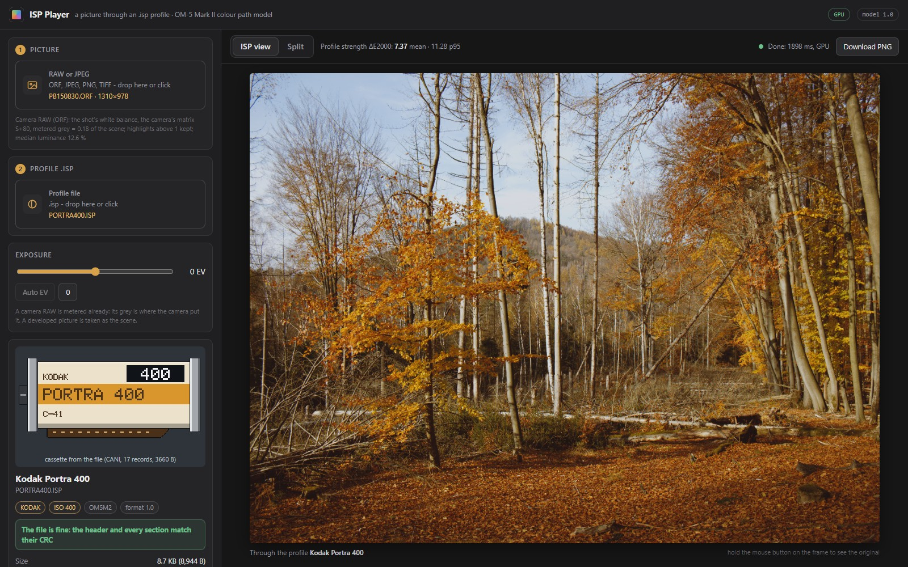

# ISP player



The ISP player is a local web page: drop a picture and an `.isp` profile on it, and it shows the picture as the
OM-5 Mark II would render it with that profile, next to the original, together with what the file holds - its name,
the cassette picture the camera shows, the colour tables and the file's checks. It fits nothing and changes no file;
it is a viewer for profiles, for example the [bundled FILMLOOK presets](../modules/filmlook/presets.md) or a profile
made by another tool.

Code: `OMKit/apps/isp_player/` (the server and the page) on top of the shared library `OMKit/apps/ispkit/`.

## 1. What it shows

- **The frame through the profile.** The picture becomes the signal the camera's colour tables receive, and the
  profile's tables run on it as the camera runs them (a model of the colour path, section 5).
- **The original**: the same picture without a look, as plain sRGB of the scene - for comparison (hold the mouse button
  on the frame, or use the split view).
- **The profile's strength**: how far the frame through the profile is from the original, CIEDE2000 (mean and 95th
  percentile over the pixels).
- **The file**: the cassette from its `CANI` section drawn as the camera draws it, the name, brand and ISO, the
  format's checks (header and section CRCs, platform, ISP block), the curves, the matrix and saturation, the 12 colour
  sectors, the `META` lines and the section table. The format is described in [formats/isp.md](../formats/isp.md).

## 2. Install

1. Python 3.10 or newer (`python --version`).
2. From the folder that holds `OMKit/`:

   ```sh
   python -m pip install -r OMKit/apps/requirements.txt
   ```

   Best in a virtual environment: [apps/README.md, Install once](README.md#install-once) shows it for Windows,
   Linux and macOS.

   This installs numpy, Pillow and rawpy. rawpy is needed only for the camera's RAW files (`.ORF`); without it the
   player still opens JPEG, PNG and TIFF and says so when a RAW is dropped.
3. Optional: PyTorch with CUDA (an NVIDIA GPU). Install the build for your CUDA version as the PyTorch site describes.
   With it the colour tables run on the GPU; without it on the CPU with numpy. The result is the same: every table set is
   checked on the CPU first, and a set the GPU would render differently is rendered on the CPU. The page's top bar says
   which is used (`GPU` or `CPU x 4`).

## 3. Start

```sh
python OMKit/apps/isp_player/run.py
```

It prints the address, `http://127.0.0.1:8790/` - open it in a browser. Options:

| Option | Meaning |
|---|---|
| `--port N` | another port (default 8790; `0` picks any free one) |
| `--open` | open the page in the default browser |

Ctrl+C in the terminal stops it. The same from inside `OMKit/apps`: `python -m isp_player [--port N] [--open]`.

Environment variables, for special cases: `ISPKIT_GPU=0` renders on the CPU even with a GPU; `ISPKIT_THREADS=N` sets the
number of CPU render threads (default up to 4).

## 4. Using the page

1. **Picture.** Drop a file on the "Picture" box, or click it and choose one: the camera's RAW (`.ORF`), JPEG, PNG or
   TIFF. Files can also be dropped anywhere on the page - an `.isp` file becomes the profile, anything else the picture;
   a picture and a profile can be dropped together. Under the box: the colour space found and how (ICC profile, EXIF, or
   none - then sRGB is assumed) and the median luminance. For a developed picture the **Colour space** list overrides
   what was found (sRGB, Display P3, Adobe RGB, ProPhoto RGB, Rec.2020, linear sRGB).
2. **Profile.** Drop or choose an `.isp` file. A profile is only ever chosen this way: the player has no list or folder
   of presets of its own.
3. **Exposure.** The slider changes the exposure in quarter steps from -3 to +3 EV before the tables, as the camera's
   exposure would. **Auto EV** chooses the exposure at which the frame through the profile is as bright as the original
   (the mean CIE L*): a developed picture already carries a tone curve, and a film look adds its own. A camera RAW is
   metered already, so Auto EV is off for it; **0** resets.
4. **The views.** *ISP view* shows the frame through the profile; hold the mouse button on it to see the original.
   *Split* shows the original on the left and the profile on the right: drag anywhere on the frame, use the arrow keys
   (Shift: steps of 10 %), double-click to centre. **Download PNG** saves the frame through the profile (8-bit sRGB, at
   the size shown).

The profile card on the left:

| Block | What it shows |
|---|---|
| cassette | the `CANI` drawing as the camera draws it in the FILMLOOK editor; a file without a valid one gets a generic cassette chosen by its name, and the caption says so |
| name, chips | the profile's name and file, the brand and ISO on the cassette, the platform, the format version; "B&W" when the saturation factor is 0 |
| verdict | green - every check passed; yellow - the file is shown, with remarks (values outside what the reference writer writes, unknown sections, parts not marked present); red - the file cannot be rendered (failed CRC, wrong platform, no ISP block) and only the original is shown |
| facts | size, the whole file's CRC-32 (FILMLOOK writes it into a shot's EXIF), the header CRC, the base picture mode, the gamma domain, the blocks rendered and the parts the file marks present |
| Curves | gamma R, G, B, the tone curve and the resulting curve as the camera's curve editor draws it |
| Matrix and saturation | the look's matrix F (hover a cell for its Q7 value), the saturation factor k, how many sectors act |
| Colour sectors | per sector: the hue at its centre with its colour, the hue window's width, the chroma addition, the hue shift and the luma addition |
| META, File sections | the provenance lines; every section with its offset, size and CRC-32 |

## 5. What the render is, and what it is not

The frame is computed by a numerical model of the camera's colour path (described in
[platform/om5m2/color-pipeline.md](../platform/om5m2/color-pipeline.md)): the matrix (the look's matrix combined with
the camera's own, rounded as the camera rounds it), the gamma curves, YCbCr with the saturation factor, the tone curve
and the 12 colour sectors, with the 8-bit output. The blocks used are the ones the file marks present, as the camera
applies them.

- **A camera RAW** gives the closest preview: the shot's own white balance and the camera's own matrix produce the signal
  the tables would receive in the camera, with highlights clipped at the sensor's white as the camera clips them. The
  RAW is shown at half resolution (a 2 x 2 sensor block per pixel).
- **A developed picture** (JPEG, PNG, TIFF) is taken as the scene: its light, decoded from its colour space, is put
  where a correctly metered shot would put it. It already has a tone curve and clipped highlights of its own, so the
  result is a fair impression of the look, not what the camera would make of that scene.
- **The original** is the picture as plain sRGB of the scene, not the camera's own Natural JPEG.

How close the model is to the camera, measured on the camera (full table: [color-pipeline.md section
6](../platform/om5m2/color-pipeline.md#6-camera-against-the-model)): on 167 real-scene frames shot with presets, the
camera's JPEGs differ from the model by a median CIEDE2000 of 1.30 on flat areas - 0.83 for colour looks up to ISO 800,
1.65 at ISO 3200, 0.05 to 0.34 for neutral black and white. Known differences: the camera lowers the chroma of deep
shadows (to 0.6..0.7 of the model below JPEG luma ~30/255), negative sector luma additions act weaker than modelled, and
saturated colours come out 2..3 % less saturated. Colours outside the sRGB gamut were not checked.

Not modelled - the frame is the colour path only:

- the camera's other picture settings: sharpness, noise filter, contrast and gradation, highlight and shadow control,
  the saturation lowered at high ISO, shading compensation, lens corrections, art filters;
- the FILMLOOK edits made on the camera (the bent tone curve) and the film grain;
- noise, and the JPEG compression of the camera.

## 6. Privacy

Everything stays on the computer. The server listens only on 127.0.0.1, so no other machine can reach it; the page
loads nothing from the internet. Pictures and profiles are kept in memory only (the last 4 pictures, 32 profiles and
12 frames), nothing is written to disk, and all of it is gone when the player stops.

## 7. Limits

| What | Limit |
|---|---|
| picture upload | 200 MB; Pillow's own guard refuses pictures of more than about 179 megapixels |
| `.isp` upload | 1 MB (the format allows at most 64 KiB) |
| shown size | at most 1400 pixels on the long side: larger pictures are thinned by a whole step (every 2nd, 3rd... pixel), not resampled |
| RAW files | `.ORF` of the OM-5 Mark II. The camera model (white balance, matrix, metering) is that camera's: an ORF of another camera opens, but its colours are not that camera's |
| other pictures | what Pillow opens: JPEG, PNG, TIFF, WebP, BMP and so on; 16-bit greyscale is read at full depth, 16-bit colour at 8 bits; the orientation from EXIF is applied |
| profiles | format 1.x, platform `OM5M2` |
| exposure | -3..+3 EV in quarter steps |

## 8. Troubleshooting

| Symptom | What to do |
|---|---|
| "cannot listen on 127.0.0.1:8790" | another program (or a second player) uses the port: start with `--port 8791` or `--port 0` |
| "reading camera RAW files needs the rawpy package" | `python -m pip install rawpy` |
| "cannot read the picture" / "cannot read the RAW file" | the file is damaged or not a format Pillow or rawpy reads; export it as JPEG, PNG or TIFF |
| "the picture is not on the server" / "the profile is not on the server" | the player was restarted, or the picture dropped out of memory after 4 newer ones: drop the file again |
| red verdict "the file failed its checks" | the file is damaged (a CRC does not match) or is not an `.isp` file; the camera would refuse it too |
| red verdict "platform ...: the model knows only OM5M2" | the profile is made for another camera |
| yellow verdict | the file is shown; the remarks say what the camera may do differently (for example a part not marked present keeps the camera's own table) |
| the colours of a JPEG look wrong | check the colour space line under the picture; choose the right one in the **Colour space** list |
| top bar shows `CPU` with an NVIDIA GPU installed | PyTorch is missing or has no CUDA: `python -c "import torch; print(torch.cuda.is_available())"` must print `True` |
| slow render | normal on the CPU for large RAW files (a fraction of a second to a few seconds); a GPU or a smaller picture helps |
| "the GPU copy of the model differs ..." in the terminal | that profile is rendered on the CPU instead; the result is still exact |
