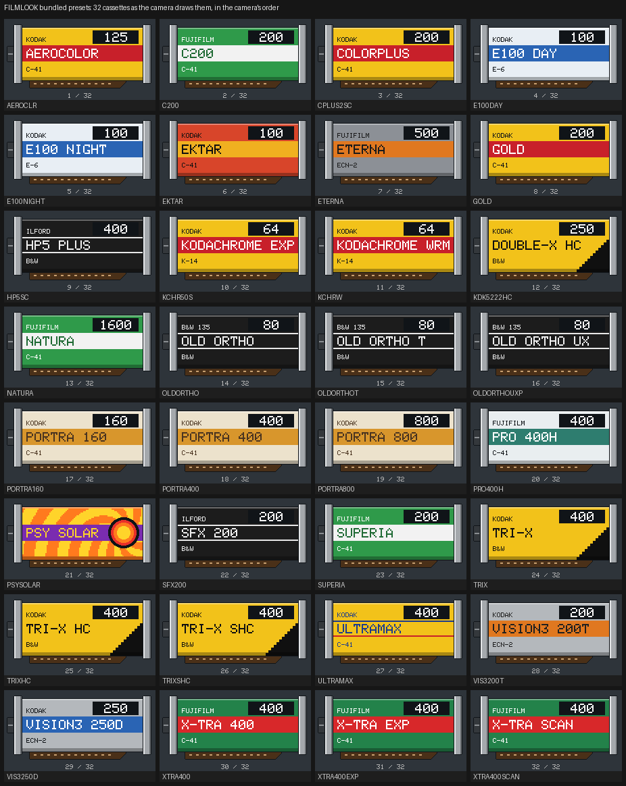

# FILMLOOK: film looks in the picture mode screen

FILMLOOK (version 1.12, needs core API 16; the grain needs API 17) puts a film look into the camera's picture mode
screen. One stock picture mode of the strip - the **slot**, i-Enhance by default - is replaced by the look. In its place
the user steps with the dials through **presets**: `.ISP` files on the card, each a set of colour tables for the camera's
image processor, usually made to look like one film. Live view and the pictures take the chosen preset at once. In the
same screen the user can bend the preset's tone curve and add film grain to the stills; both are kept per preset.

| Page | Contents |
|---|---|
| this page | what the module does, how it is used, its settings, files, store and log |
| [presets.md](presets.md) | the 32 bundled presets, their names and order, installing and adding presets |
| [grain.md](grain.md) | the 11 bundled grain tiles, how grain is chosen, the tone mask and colour grain |

## 1. Getting started

With an OMKit release (or the card bundle, `make -C OMKit card`) there is nothing to do: its `OMKIT` folder has
`MODULES\FILMLOOK.OMM`, the presets in `FILMLOOK\`, the grain tiles in `GRAIN\` and an `OMKIT.INI` that already has
`FILMLOOK = on`. Copy the folder to the card and switch the camera on: the strip shows "Film Look" in the place of
i-Enhance.

On a card put together by hand:

1. Copy `MODULES\FILMLOOK.OMM`, the presets in `FILMLOOK\` and the grain tiles in `GRAIN\` to the card's `OMKIT` folder
   ([presets.md](presets.md#5-installing-the-set), [grain.md](grain.md#6-installing-and-adding-tiles)).
2. Switch the camera on once with the card in it: if there is no `OMKIT\OMKIT.INI`, `core` writes its sample, which
   loads no module ([../../config.md](../../config.md)).
3. In `OMKIT.INI` add the module to `[modules]`:

   ```ini
   [modules]
   enabled = on
   FILMLOOK = on
   ```

4. Switch the camera off and on. In the picture mode screen the strip shows "Film Look" in the place of i-Enhance.

Settings (section 5) go into a section `[FILMLOOK]`; none is needed for the defaults.

## 2. On the camera

### 2.1. The look in the strip

- The look takes the slot's place in the picture mode strip, with its own pictures (strip and large icon, the "Picture
  Mode" menu line, the control panel cell, the shooting screen sign) and its own name over the strip (`name`, "Film Look"
  by default). The slot's stock mode is not available while the module runs.
- Choosing the look turns it on; choosing any other picture mode turns it off. The look and a CREATPRF profile exclude
  each other.
- The camera stores Natural as its picture mode while the look is on, so the camera's saved settings stay stock; the look
  itself is applied from memory. A shot with the look is a Natural shot with the preset's colour tables, whatever the
  slot is.
- The look's on/off state and the chosen preset are remembered and brought back at the next power-on. If the camera's
  stored picture mode is no longer Natural by then (it was changed without OMKit, for example with the card out), the
  look stays off until it is chosen again.
- At power-on the chosen preset comes back first: its file is read and its colour tables (with its stored edits) are in
  force before the other presets are read, so a picture taken in the first seconds already has the look's colours. The
  grain follows a moment later, when its tile is loaded; a picture taken before that has the colours without the grain.
- If the slot's own mode was the stored picture mode before the module was installed (i-Enhance was in use), the strip
  shows the look but the pictures are real i-Enhance pictures until the look is chosen again.

### 2.2. Choosing a preset

The look's column in the picture mode screen starts with the look's own item: the chosen preset's **cassette picture**
with "n / N" (its number and the count) under it, or, for a preset without a cassette picture, a grey rectangle with the
preset's name. The dial labels read "Prev" and "Next". The cassette starts as far under the dial labels as the tone
curve's window does (core 1.29).

- The front and rear dials step through the presets, one preset per click; after the last comes the first.
- Live view changes at once; the next picture is taken with the new preset.
- The presets are listed in the order of their file names (section 4.2) and shown by the profile name in their file.
- No presets on the card: the item shows "no presets" and the look changes nothing.

### 2.3. The editors

With `enable_edits = on` (the default) the look's item is followed by editors of the chosen preset. They change a copy
of the preset in memory, never the file, and are kept per preset (section 6).

| Item | Shown when | Rear dial | Front dial | INFO | Long OK |
|---|---|---|---|---|---|
| Tone curve | the preset has a gamma and a tone curve (every bundled one does) | the highlights ("Hi", the right label), as in the camera's Highlight & Shadow screen | the shadows ("Sh", the left label) | both dials edit the mid tones; again - back | all three back to 0 |
| Film grain | `grain = on` and at least one valid tile in `OMKIT\GRAIN\` | the tile ("Tile") | the strength Off, Low, Med, High ("Level") | - | strength Off |

- **Tone curve.** The drawing shows the preset's own curve with three points: shadows, mid tones, highlights. Each point
  moves -7..+7 steps; a step lifts or lowers the curve's output at that point by about 2 % of the range, smoothly to both
  sides; the ends of the curve stay. Live view follows at once. The dial labels stand as on the camera's Highlight &
  Shadow screen: "Sh" on the left, over the shadows of the graph, "Hi" on the right, each with the pictogram of the dial
  that edits it; after INFO both read "Mid" (core 1.28; before it "Hi" stood on the left).
- **Dial labels.** Every label over the dials is in the camera's own face and size, at the same place under its dial
  pictogram as the camera's "Color" and "Vivid" (FILMLOOK 1.10, core 1.29). The grain item's read "Tile" and "Level":
  "Type" and "Strength" of FILMLOOK 1.9 do not fit that size.
- **Film grain.** The drawing is a cassette with the tile's name, a strip of four pictograms Off, Low, Med, High with the
  chosen one framed in yellow, and "n / N" of the tile. The tile steps round through all tiles; the strength stops at Off
  and High. Grain goes on **stills only**, never on live view or video; the shooting screen does not change. A preset
  never edited starts at Off with the default tile (`grain_tile`). Details: [grain.md](grain.md).

**Not shown.** The code also holds a saturation editor per colour sector (Color/Vivid) and a black-and-white filter
editor (Color/Level), but both are taken out in this version: they are not shown, and edits of them stored by earlier
versions are dropped (section 6).

### 2.4. What the pictures get

| | Live view | Stills |
|---|---|---|
| the preset's colour tables, with the tone curve edit | yes, with `scope = both` or `live` | yes, with `scope = both` or `stills` |
| grain | never | when the strength is not Off; not on multi-frame shots (High Res Shot and the like) |
| colour grain (`[grain] chroma`) | never | colour presets only |

The camera's other settings of Natural (sharpness, contrast, noise filter and so on) stay as they are. Which stills get
grain in detail: [../../platform/om5m2/grain.md](../../platform/om5m2/grain.md#31-which-stills-get-grain).

### 2.5. Black and white or colour

A preset is black and white when its colour gains remove all colour, or when its colour matrix makes R, G and B one mix -
the one rule of [formats/isp.md section 5.1](../../formats/isp.md#51-black-and-white-blocks); a toned black and white
(tinted by its curves) still counts as black and white. A black-and-white preset never gets colour grain. The log line
of a preset says which it is (section 8). Of the bundled presets 9 are black and white ([presets.md](presets.md)).

## 3. Cassette pictures

A preset may carry its own cassette picture (the `CANI` section of its file, [formats/isp.md section
5a](../../formats/isp.md#5a-cani-the-cassette-picture)). The camera draws it in the look's item, with the preset's number
under it. Every bundled preset has one: a stylised film cassette with the maker, the film, the speed and the process
written on it ([presets.md](presets.md#2-the-set)).



*The cassettes of the bundled presets as the camera draws them, in the camera's order, with the file name under each.*

- `core` checks a picture once at power-on; one that fails is refused with the reason in the log, and that preset shows
  the rectangle with its name.
- `art = off` shows the rectangle for every preset.
- The rectangle shows the name in OMKit's 5 x 8 font (the classic 5x7 font of the Adafruit GFX Library, see NOTICE): large up to 17 characters, smaller for a longer name.

## 4. Preset files

### 4.1. Where they are

| | |
|---|---|
| Folder | `OMKIT\FILMLOOK\` on the card. `core` creates it at the module's first start if it is not there |
| Files | `*.ISP`, the format in [formats/isp.md](../../formats/isp.md), for the platform `OM5M2` |
| Names | 8.3 names (`PORTRA400.ISP`) or long names up to 39 characters of printable ASCII (`Kodak Portra 400.ISP`). Longer names, names with other characters and empty files are skipped (the log counts them) |
| Size | under 16 KiB per file (a bundled preset is 8-9 KiB). A larger file is skipped |
| Count | at most 64 presets |
| Shown as | the profile name in the file's header (up to 31 characters; other than printable ASCII shows as `?`); a file without one is shown by its file name |

With `presets =` empty (the default) the module lists every `.ISP` of the folder. With more than 64 files in the
folder only 64 are listed, and which ones depends on the order of the folder on the card; the log warns about it
(section 8). Keep at most 64 there, or name the ones to show in `presets =`.

### 4.2. Order

By file name, without case, character by character: digits before letters, and a shorter name before a longer one that
starts the same (`OLDORTHO.ISP`, `OLDORTHOT.ISP`). So the variants of one film stand together. `presets =` gives an order
of its own (section 5).

### 4.3. Checks

At power-on every file is read once and checked: the magic and format version, the platform `OM5M2`, the size in the
header against the file, the header CRC, the CRC of every section, and an `ISPB` section must be present. A file that
fails is skipped with the reason in the log. The same read gives the preset's name, the CRC-32 of the whole file and its
cassette picture. When a preset is chosen its file is read again and its colour block must have the platform's size; if
it fails then, the camera's own tables stay and the log says why. (The preset that was chosen at power-off is read one
more time, before all the others, to bring the look back early.)

### 4.4. Adding your own presets

1. With the card in a computer, copy the `.ISP` file into `OMKIT\FILMLOOK\`. Choose its file name for the place it
   should take in the order.
2. Switch the camera on. The log line `N presets in OMKIT\FILMLOOK\` counts them; a skipped file has a line with the
   reason.

The bundled presets and your own stand side by side in the folder; replacing the bundled set keeps files it does not
list ([presets.md](presets.md#5-installing-the-set)). A file written to the format of [formats/isp.md](../../formats/isp.md)
is a preset; the module needs nothing else. Changing a file drops its stored edits (section 6).

## 5. Settings

Section `[FILMLOOK]` in `OMKIT.INI` (rules of the file: [../../config.md](../../config.md)). Values are written in lower
case as below.

| Key | Default | Values | Effect |
|---|---|---|---|
| `slot` | `ienhance` | `ienhance`, `vivid`, `muted`, `portrait`, `monotone`, `underwater` (any case) | the stock picture mode the look replaces. Natural, Color Creator, Custom, e-Portrait and the ART filters cannot be slots. Another value: the module does not start, and the log lists the slots |
| `name` | `Film Look` | up to 23 characters, printable ASCII | the look's name over the strip, in place of the slot mode's name (in every menu language). Longer names are cut; other characters show as `?`. Empty: the slot keeps its stock name (a warning) |
| `presets` | empty | file names without `.ISP`, separated by commas | only these presets, in this order. Empty - every `.ISP` of the folder, by name. A name up to 35 characters, spaces inside allowed; a name that is repeated counts once; a file that is not there gets a log line |
| `scope` | `both` | `both`, `stills`, `live` | where the preset's colour tables apply: live view and stills, stills only, or live view only. Any case (`Stills`); another value - a warning and `both` |
| `art` | `on` | switch | `off` - the grey rectangle with the name for every preset instead of the cassette pictures |
| `enable_edits` | `on` | switch | `off` - no editors and no grain item; the presets act exactly as their files. Stored edits are kept but not used |
| `save_preset_edits` | `on` | switch | `on` - every preset keeps its edits across preset changes and power-offs. `off` - an edit lasts only while its preset stays chosen: choosing another preset resets the edits (the grain too), and nothing is stored |
| `grain` | `on` | switch | `off` - no grain item and no grain. The grain also needs `enable_edits = on` |
| `grain_tile` | empty | a tile's file name, with or without `.GRN` (`CLASS400`) | the tile of a preset not edited yet. Empty, or a tile that is not there (a warning): the first tile by file name |
| `exif` | `off` | switch | `on` - write the preset, its edits and its matrix into the JPEG's UserComment (section 7). For checking a preset on the computer |

Two more keys are read by `core` for every module (`memory`, `event_<event>`): [../../config.md](../../config.md#6-keys-core-reads-in-every-modules-section).

The grain's tone mask and colour grain are `core` settings in `[grain]`: [grain.md](grain.md#4-the-tone-mask-and-colour-grain).

## 6. What is kept, and when edits are dropped

The module's store is `OMKIT\STORE\FILMLOOK.STA` and `.STB` (two copies, written 1.5 s after a change and at power-off).

| Kept | How |
|---|---|
| whether the look is on | brought back at power-on (if the stored picture mode is still Natural) |
| the chosen preset | by its file name |
| each preset's edits: the tone curve's three points, the grain tile and strength | by the preset's file name and the CRC-32 of the whole file; at most 64 presets with edits |

Edits are dropped when:

- **the file changed.** Any change of the file - its tables, its profile name, its cassette picture - changes its CRC; at
  the next power-on its edits are dropped (`NAME: the file changed, its edits dropped`). Copying the same file again keeps
  them;
- the file is renamed: the edits stay in the store under the old name and come back if the old name does;
- `save_preset_edits = off`: edits are not stored, and choosing another preset resets the edits of the one left;
- they were made by FILMLOOK 1.2 or older (`edits of an older FILMLOOK dropped`), or they are Color/Vivid or Color/Level
  edits of an earlier version (`Color/Vivid and Color/Level edits dropped`): those editors are not shown in this version;
- the stored grain tile's file is gone: the grain item shows "NONE" and the preset gets no grain until a tile is chosen.

Edits of a preset whose file is not on the card stay in the store; they come back with the unchanged file. Only when
all 64 places are taken and a preset on the card needs one, the first such record gives way (`NAME: its edits take the
place of a preset's that is not on the card`, FILMLOOK 1.11). To forget
everything the module keeps, delete `FILMLOOK.STA` and `FILMLOOK.STB` from `OMKIT\STORE\` with the card in a computer.

## 7. EXIF text (`exif = on`)

With `exif = on` every JPEG taken with the look carries a text in its EXIF UserComment (at most 117 characters):

```
FILMLOOK <file> CRC <crc> [E [t=<shadows>,<mid>,<highlights>] [g=<tile>,<strength>]] [F <matrix>] '<profile name>'
```

| Part | Meaning |
|---|---|
| `<file>` | the preset's file name; spaces in it are written as `_` |
| `CRC <crc>` | the CRC-32 of the whole file, 8 hex digits: tells which version of the file it was |
| `E ...` | present only when the preset is edited: `t=` the tone curve's points -7..7, `g=` the grain tile (file name without `.GRN`) and strength 1 Low, 2 Med, 3 High |
| `F <matrix>` | the preset's colour matrix, 9 numbers in three groups (rows), 128 = 1.0 |
| `'<profile name>'` | the name in the file's header |

A text longer than 117 characters is cut and ends in `~`. When the look is turned off the camera's own UserComment comes
back. The text is meant for checking presets; leave `exif = off` otherwise.

## 8. Log lines

FILMLOOK writes its lines to `OMKIT\LOG\CORE.LOG` with the prefix `FILMLOOK:`. The ones a user may meet:

| Line | Meaning |
|---|---|
| `N presets in OMKIT\FILMLOOK\` | presets found at power-on (a warning when 0) |
| `NAME: cannot open (in OMKIT\FILMLOOK\)` | a file named in `presets =` is not there |
| `NAME: <reason>, skipped` | a file failed the checks of section 4.3, or is 16 KiB or larger (`larger than an .isp can be`) |
| `NAME: more than 64 presets, skipped` | `presets =` names more than 64 files |
| `more than 64 .ISP files in OMKIT\FILMLOOK\: the first 64 in the folder's order are listed, the rest left out` | the folder holds more than 64 presets (section 4.1) |
| `scope = X: not both, stills or live - both` | an unknown `scope` value |
| `file_list(*.ISP): N names skipped (...)` (from `core`) | long names over 39 characters or not printable ASCII |
| `edits of N presets restored` | stored edits found for N presets on the card |
| `NAME: the file changed, its edits dropped` | see section 6 |
| `grain: N tiles, the default TILE` | the grain item is on |
| `grain: off (grain or enable_edits)`, `grain: no tiles from core` | no grain item, and why |
| `grain_tile = X: no such tile, the first one is the default` | `grain_tile` names a missing tile |
| `N cassette pictures, M presets without one` | cassette pictures set at power-on |
| `FILE (CRC xxxxxxxx): its tables are on, before the presets are read` | power-on with the look on: the chosen preset's colour tables are in force already |
| `look restored, preset N 'NAME'` / `look not restored, code -4` | the look came back at power-on / the stored picture mode was not Natural |
| `look turned off while the presets were read` | the user chose another picture mode in the first second or two after power-on, while the look was coming back: the look is off |
| `look on, preset N of M`, `look off` | the user chose the look or left it |
| `preset N 'NAME' (FILE, CRC xxxxxxxx) on, colour` | a preset was applied; `edited` when it has edits; `black and white (no colour grain)` for a black-and-white one |
| `preset N: grain TILE, strength L` | a grain choice (strength 0 Off .. 3 High) |
| `FILE: <reason>, the camera's own tables stay` | the chosen preset's file failed when it was read again |
| `the film look is not available in slot X, code N` | wrong `slot` (or the look is taken): the module stops |
| `the ISP service is not available, code N` | another module took the colour table service: the module stops |
| `NAME: its edits take the place of a preset's that is not on the card` | 64 presets had stored edits; the record of a file no longer on the card was dropped for this one |
| `NAME: no room for its edits in the store` | 64 presets on the card already have stored edits |

`core`'s own lines about the look start with `look:` (for example `look: no slot 'x' here; slots: ...`, `look: entry N:
cassette picture refused: <reason>`), its grain lines with `grain:`. More detail with `log_level = debug` in `[core]`.

## 9. Limits

| What | Limit |
|---|---|
| presets | 64 |
| a preset file | under 16 KiB; a long file name up to 39 characters; `presets =` names up to 35 characters (without `.ISP`) |
| a preset's name shown | 31 characters |
| the look's name (`name`) | 23 characters |
| stored edits | 64 presets |
| grain tiles | 32 (core) |
| EXIF text | 117 characters |

## 10. Technical details

- The module uses the film look service (`look_*`, API 14-17), the ISP colour table service (`isp_scope`,
  `isp_override`, API 13) and the grain service (`grain_list`, `look_grain`, API 17): [../../sdk.md](../../sdk.md). It
  takes the ISP service first (the slot's hooks go in then); a second module that wants the same service makes it fail.
- The order at power-on: the store, the two services (their hooks), the chosen preset's tables when the look was on,
  then every preset file - one open and one read each, which gives the checks, the name, the CRC-32 and the cassette
  picture - the stored edits, the grain tiles, the pictures, the list for the UI. Opening a file is the slow part (tens
  of milliseconds each on the card), so the number of opens is what the start costs: one per preset, plus one for the
  preset that comes back.
- A preset's colour block is read from the card once, when the preset becomes the chosen one; an edit changes a copy in
  memory and is handed to the ISP service at most every 40 ms. Its pictures (the 12 of the strip, the menus, the column
  and the dial labels) come from the module file, which `core` has in memory while the module starts.
- How the slot, the column and the dials work in the camera: [../../platform/om5m2/picture-modes.md](../../platform/om5m2/picture-modes.md#9-omkit-the-film-look-slot),
  [../../platform/om5m2/ui.md](../../platform/om5m2/ui.md#44-the-film-looks-items); the colour path the tables replace:
  [../../platform/om5m2/color-pipeline.md](../../platform/om5m2/color-pipeline.md).
- Source: `src/modules/filmlook/` (`filmlook.c`, `edits.c`, `ispfile.c` - the file checks and the CRC-32); its pictures
  are made by `tools/mkicons_film.py`.
