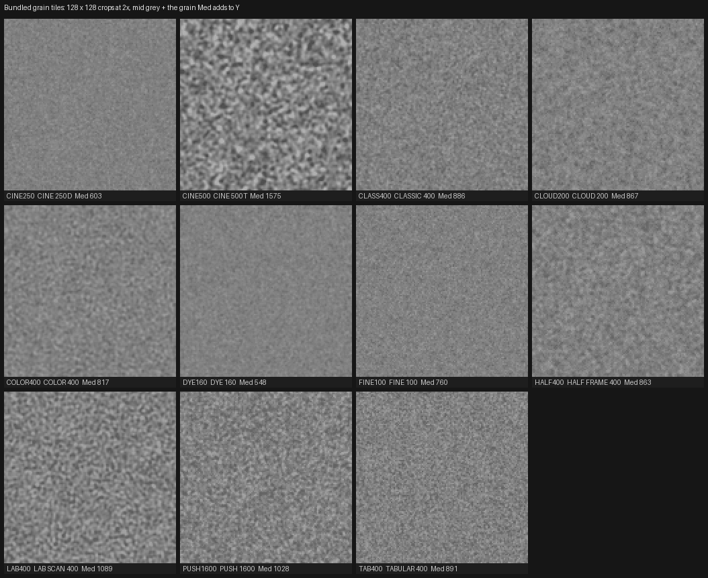

# FILMLOOK: film grain and the bundled tiles

FILMLOOK can put film grain on the stills of the look. The grain comes from **tiles**: small squares of grain kept in
`.GRN` files in `OMKIT\GRAIN\` ([../../formats/grn.md](../../formats/grn.md)). For every preset the user chooses a tile
and a strength - Off, Low, Med or High - in the look's grain item. `core` owns the tiles and puts the grain on the
pictures; how the camera does it is in [../../platform/om5m2/grain.md](../../platform/om5m2/grain.md).

## 1. What the grain does and does not do

- Stills only: JPEG (also the JPEG of RAW+JPEG), every frame of a burst. Never live view or video; the shooting screen does
  not change when grain is on.
- Not on multi-frame shots (High Res Shot and the like); such a still is taken without grain and the log says why.
- The tile repeats over the whole picture, shifted to a new random place for every still, so two stills do not share a
  pattern (the two parts of one RAW+JPEG press can).
- The grain does not change the brightness of the picture: the tile's mean is taken away before it is added.
- It is added to the brightness (Y) after the preset's tone curve. With the default tone mask it is weaker in the
  shadows and highlights, as on film (section 4).

## 2. Choosing the grain

The grain item follows the tone curve in the look's column. It is shown when `enable_edits = on` and `grain = on` in
`[FILMLOOK]` (both are the default) and `OMKIT\GRAIN\` holds at least one valid tile.

| Control | Effect |
|---|---|
| rear dial ("Tile") | the next or previous tile, round through all tiles in the order of their file names |
| front dial ("Level") | Off, Low, Med, High; stops at both ends |
| long OK | strength Off |

- The item shows a cassette with the tile's name in capitals, four pictograms Off, Low, Med, High with the chosen one
  framed in yellow, and "n / N" of the tile.
- The choice belongs to the preset shown: every preset keeps its own tile and strength, stored with its other edits
  ([README.md](README.md#6-what-is-kept-and-when-edits-are-dropped)).
- A preset never edited starts at **Off** with the default tile: `grain_tile =` in `[FILMLOOK]` (for example
  `CLASS400`), or the first tile by file name (`CINE250` with the bundled set).
- A chosen tile is read from the card 0.3 s after the dial stops; that takes 0.2 to 0.5 s. A still taken before the tile
  is loaded has no grain.
- If a preset's stored tile file is gone, the item shows "NONE" and the preset gets no grain until another tile is
  chosen.
- With `exif = on` the JPEG's text carries `g=TILE,STRENGTH` ([README.md](README.md#7-exif-text-exif--on)).

## 3. The bundled tiles

`resources/modules/filmlook/grain/` in the source tree, `OMKIT\GRAIN\` on a card made with `make -C OMKit card`: 11
tiles and `manifest.json`.

| File | Name shown | Side | Low | Med | High | Structure |
|---|---|---|---|---|---|---|
| `CINE250.GRN` | CINE 250D | 512 | 423 | 603 | 844 | fine |
| `CINE500.GRN` | CINE 500T | 768 | 1132 | 1575 | 2047 | coarse, the coarsest of the set |
| `CLASS400.GRN` | CLASSIC 400 | 512 | 532 | 886 | 1240 | medium |
| `CLOUD200.GRN` | CLOUD 200 | 768 | 520 | 867 | 1214 | coarse |
| `COLOR400.GRN` | COLOR 400 | 512 | 490 | 817 | 1144 | medium |
| `DYE160.GRN` | DYE 160 | 512 | 384 | 548 | 767 | medium; the lowest gains of the set |
| `FINE100.GRN` | FINE 100 | 512 | 456 | 760 | 1063 | fine |
| `HALF400.GRN` | HALF FRAME 400 | 512 | 518 | 863 | 1208 | coarse |
| `LAB400.GRN` | LAB SCAN 400 | 512 | 653 | 1089 | 1525 | medium |
| `PUSH1600.GRN` | PUSH 1600 | 512 | 617 | 1028 | 1439 | medium |
| `TAB400.GRN` | TABULAR 400 | 512 | 535 | 891 | 1247 | fine, the finest of the set |

- **Side** - the tile's size in pixels; the camera repeats it over the picture.
- **Low, Med, High** - the gains of the three strengths, carried in each file. A gain of 1024 adds the tile's deviation
  one to one to the brightness; the gains go up to 2047. Med is meant to match the grain of the film class in the mid
  tones; High is about 1.4 x Med and Low about 0.6 x Med.
- **Structure** - how much of the tile's grain is fine detail, read from the grain spectrum recorded in `manifest.json`
  for each tile (its value at 0.3 cycles per pixel: 0.4 and more - fine, 0.2 to 0.4 - medium, under 0.2 - coarse). The
  name says which film class the tile was made after: a 35 mm frame's grain at the scale of one pixel of a 3:2 still.

*A 128 x 128 crop of each tile, enlarged 2 x, shown as the strength Med adds it to a mid grey (128 + (tile value - its
mean) x Med gain / 1024; at mid grey the default tone mask gives the full gain). On the picture the grain is weaker in
the shadows and highlights.*

## 4. The tone mask and colour grain

These are settings of `core`, in `[grain]` of `OMKIT.INI`, and act on every preset ([../../config.md](../../config.md#5-grain)).

| Key | Default | Effect |
|---|---|---|
| `mask` | `film` | `film` - the grain follows the tone as on film: full in the mid tones, about half in the deep shadows and a little more than half in the highlights; `flat` - the same in every tone; `off` - the same in every tone by an older route of the camera (the fallback if `film` or `flat` give trouble) |
| `chroma` | `0` | 0..1024: colour grain - noise in the colour as well, on colour presets only; 0 - none. At 100 the colour deviation is about 4 levels |

Colour grain is never put on a black-and-white preset (the rule:
[../../formats/isp.md section 5.1](../../formats/isp.md#51-black-and-white-blocks)). There is no menu item for either key.
The curve of the `film` mask: [../../platform/om5m2/grain.md](../../platform/om5m2/grain.md#36-the-tone-mask-curve).

## 5. What it costs

- The grain needs a large picture buffer: while the look is on with a strength other than Off, the camera keeps its
  image memory in the layout of its ART filters. A grain still takes about 0.7 to 0.9 s to develop.
- `core` keeps one tile in memory, as large as the largest tile on the card (576 KiB for a 768 x 768 tile).

## 6. Installing and adding tiles

| Way | What it does |
|---|---|
| `make -C OMKit card` | builds the card bundle; its `OMKIT/GRAIN/` holds the set |
| `python3 OMKit/tools/grainset.py check [DIR]` | checks the set folder against its `manifest.json`: sizes, SHA-256 and the checks `core` makes; a `.GRN` the manifest does not list is an error |
| `python3 OMKit/tools/grainset.py copy DEST [DIR]` | checks, then copies the set into `DEST` and **removes any other `.GRN` there** |
| by hand | copy the `.GRN` files into `OMKIT\GRAIN\` on the card |

To add a tile of your own, copy a `.GRN` file made to [../../formats/grn.md](../../formats/grn.md) into `OMKIT\GRAIN\`
next to the others (by hand: `grainset.py copy` would remove it).

| Rule | Detail |
|---|---|
| File name | 8.3, `NAME.GRN`; the tiles are offered in the order of their file names. The file name is what a preset's choice is stored by: renaming a tile makes the presets that used it show "NONE" |
| Name shown | 1 to 23 printable ASCII characters in the file's header, drawn in capitals on the item |
| Side | 128, 192, 256, 384, 512 or 768 pixels; values 0..63; the tile must be seamless |
| Gains | in the file: Low, Med, High (each up to 2047, not falling), or only the tile's gain (up to 1024) with Low, Med, High = 0.25, 0.55 and 1 x it |
| Count | at most 32 tiles |

At power-on `core` checks every tile's header; a bad one is left out with the reason in the log (`grain: FILE: <reason>,
left out`). The log also lists every good tile with its side, mean and gains (`grain: tile N: FILE 'NAME', ...`), and each
load (`grain: tile FILE 'NAME' loaded in N ms`). A tile whose pixels fail their check when it is loaded gives no grain
(`grain: FILE: <reason>, no grain with it`).
