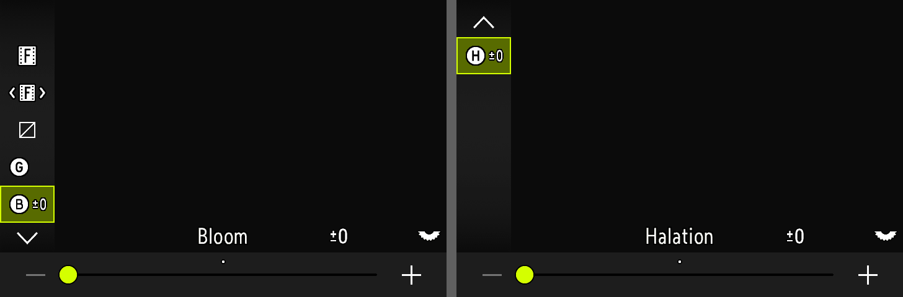

# Bloom and Halation

Two optical effects for the stills of the film look, set per preset in the look's column of the picture mode screen:

- **Bloom** - the soft glow of a diffusion filter in front of the lens:
  bright parts of the picture glow into the darker ones around them, with a long and faint tail, in the colour of their
  light.
- **Halation** - the halo of a colour film without an anti-halation layer (for example motion picture film used in a
  still camera): light that went through the film is reflected back from its base and exposes the red layer again
  around the brightest points. Lamps, flames and street lights get a red edge that turns orange where it is
  strong; the lamp's own core stays white.

Both are made by OMKit's `core` (its optics layer) on the look's stills; FILMLOOK gives the user the two rows to set
them.

| Page | Contents |
|---|---|
| [README.md](README.md) | the film look: presets, editors, settings, store, log |
| this page | Bloom and Halation: the rows, what the pictures get, the limitations, the `[optics]` settings |

## 1. Turning them on

Bloom and Halation need:

- a `core` with the optics layer (core API 20) and FILMLOOK with the optics rows;
- `layer = on` in the `[optics]` section of `OMKIT.INI` (section 6);
- in `[FILMLOOK]`: `optics = on` and `enable_edits = on` (both are the defaults,
  [README.md section 5](README.md#5-settings)).

Without one of them the rows are not shown and no still gets the effects. Every preset starts with both rows at 0: the
effects are off until they are turned up.

## 2. On the camera



*The Bloom row, the last item of the first page of the look's column, and the Halation row on the second page, both
at 0 (as drawn by the emulator: live view is black there).*

The look's column has two more rows after the grain item: **B - Bloom** and **H - Halation**. Their signs are a letter in
a disc, like the **G** of the grain item. The column takes two pages: Bloom ends the first one, Halation is alone on the
second (step down from Bloom).

- **Strength 0..5** on a slider, as the camera's own sliders (sharpness, contrast): the dials or the arrow keys move it,
  and the number next to the sign shows it (`±0` at 0, `+1`..`+5`). **0 is off**; 1 is subtle, 5 is strong.
- **Long OK** on a row sets it back to 0 (the slider shows "Reset" while it is not 0). On a row already at 0 a long OK
  closes the screen, as on the camera's own items.
- **Per preset.** Each preset keeps its own Bloom and Halation, like its tone curve and grain: a warm tungsten preset may
  have Halation 3, a black-and-white one Bloom 2, another none. They are stored with the preset's edits and come back at
  the next power-on ([README.md section 6](README.md#6-what-is-kept-and-when-edits-are-dropped)). When the dials step to
  another preset, the rows show its strengths at once.
- **The same look on every preset.** Film presets end their tone curve at different whites (a print white of the film:
  from code 204 to 255 among the bundled presets). The effects read the picture on the preset's own scale, from black to
  its white, so one strength looks alike on a preset with a dim white and on one with a full white, and a bright
  sharpening edge past the white is not taken for a lamp. The white of a preset is computed from its tables, edits of
  the tone curve included.
- **Black-and-white presets** get both effects without colour: Bloom is a grey glow, Halation a bright halo with no red
  ([README.md section 2.5](README.md#25-black-and-white-or-colour) says which presets are black and white).
- **EXIF.** With `exif = on` in `[FILMLOOK]` the strengths are written into the JPEG's UserComment as ` o=B,H` (Bloom,
  Halation) when either is not 0 ([README.md section 7](README.md#7-exif-text-exif--on)).

### 2.1. What each effect does

| | Bloom | Halation |
|---|---|---|
| Glows from | bright parts of the picture: lamps and windows, but also white paper, a shirt, clouds; more from the brighter ones | only the brightest points: lamps, flames, street lights, specular highlights at the white of the preset |
| Shape | a near glow and a long, faint tail around it | a narrow halo hugging the source |
| Colour | the colour of the light that glows (warm around a tungsten lamp); grey on black-and-white presets | red at the faint edge, orange where strong, the core white; none on black-and-white presets |
| On bright places | less: already-bright areas are lifted only a little, the dark ones around them more | none on white |
| Steps | about x1.5 from one step to the next | 1-3 subtle, 4 and 5 clearly stronger |

## 3. What the pictures get

| | Bloom and Halation |
|---|---|
| live view, the shooting screen | **never** (section 4) |
| stills of the look (JPEG) | yes, when the preset's strength is not 0 |
| RAW (ORF) | never: a RAW file has no picture processing |
| RAW+JPEG | the JPEG only; the preview inside the ORF is without them (setting `jobs`, section 6) |
| playback on the camera | as the JPEG: with them |
| burst | every frame |
| multi-frame shots (High Res Shot and the like), video | never |
| other picture modes, CREATPRF profiles | never: only the film look's stills |

## 4. Limitations

- **Only on the still, not in live view.** The effects are computed from the developed picture after the shot; live view
  and the shooting screen do not show them. Check them in playback.
- **A still with them is written later.** The computation takes a few tenths of a second on the camera's processor per
  picture, so the picture is on the card about 2.3-2.9 s after the shutter release, against about 1.6-1.9 s without
  them. Bursts are taken as usual, only writing them takes longer.
- **A lamp and a blown white look the same in a JPEG.** The effects see the picture after the tone curve, where a lamp
  and white paper in the sun are both at the white of the preset. So bright white surfaces in sunlight get a faint edge
  of Halation too, and a light source that is not near white in the picture (underexposed) gets none. Halation is tuned
  to look acceptable in both cases: orange, with a white core.
- **RAW+JPEG: only the JPEG.** The RAW file never carries the effects, and the preview inside the ORF (what a computer
  shows for the RAW file before converting it) is without them. The camera's playback shows the JPEG, with them.
- **Going back to an older FILMLOOK loses the edits.** FILMLOOK with the optics rows stores a preset's edits in a new
  format (its tone curve, grain and Bloom and Halation together). An earlier FILMLOOK does not know that format: at its
  start it drops such edits - all of them, the tone curve and the grain too - with the line `NAME: edits of an older
  FILMLOOK dropped`, and removes them from the store, so they do not come back with the newer version either. Edits of
  presets not changed since the update are kept.

## 5. Log lines

| Line | Meaning |
|---|---|
| `FILMLOOK: optics rows: on` | the module shows the rows; `off (optics or enable_edits)` or `core before API 20` - not, and why |
| `FILMLOOK: preset N: bloom V`, `... halation V` | a strength set on the camera |
| `look: optics rows off (no optics layer: [optics] layer)` | `layer = off`: the rows are not shown |
| `look: optics rows not shown, code N` | the rows could not be put in the column on this firmware |
| `optics: the look's strengths now: Bloom B, Halation H` | the strengths the next stills take (the chosen preset's); `black and white (the halation without colour)` for a black-and-white preset; `(no step in its stills)` when both are 0 |
| `optics: the look's white now: code W (...)` | the white of the preset in force (section 2) |
| `optics: KEY = N out of LO..HI, D taken` | a value of `[optics]` out of its range |

## 6. Settings: `[optics]`

`core` reads the section `[optics]` of `OMKIT.INI` at power-on (rules of the file: [../../config.md](../../config.md)).
The defaults below are the tuning OMKit is released with; a key left out keeps its default. The settings act on every
preset: the per-preset choice is the strength of the rows, and the gains below are those of strength 5.

Change them only to tune the look of the effects; write only the keys you change (the file takes at most 128 entries).
A number out of range is clamped, with a warning in the log. Keys not on this page are for development; leave them out.

### 6.1. On and off

| Key | Default | Values | Effect |
|---|---|---|---|
| `layer` | `on` | switch | `off` - no Bloom and no Halation, and no rows in the look's column |
| `jobs` | `first` | `first`, `both` | RAW+JPEG: `first` - the effects only on the JPEG; `both` - also on the preview inside the ORF, at the cost of a second computation per press (the picture is written even later) |
| `white` | `auto` | `auto`, `table`, `layer`, `off`, 160..255 | the scale the codes below are read on: `auto` - from black to the white of the preset (section 2), computed from its tables or, for tables without a tone curve, found in the picture (`table`, `layer` - only one of the two); `off` - the codes as they are, 0..255; a number - that code is white for every preset |

### 6.2. Bloom

| Key | Default | Range | Effect, and when to change it |
|---|---|---|---|
| `bloom_gain` | `110` | 0..5000 | the strength of Bloom at 5, percent. The main control: lower it if 1 is already too much, raise it if 5 is not enough |
| `bloom_steps` | `20, 32, 50, 71, 100` | five numbers 0..200 | strengths 1..5 in percent of `bloom_gain` |
| `bloom_threshold` | `180` | 0..254 | the code (on the preset's scale) from which a place glows. Higher - only the brightest places glow, bright surfaces stay clean |
| `bloom_emission` | `4` | 0..64 | how much brighter than white a blown place is taken to be: higher - lamps glow much more than white paper; 0 - the glow is just the excess over the threshold |
| `bloom_sigma` | `90` | 0..1000 | the size of the near glow, pixels of the picture (a Gaussian's sigma on a 5184-pixel-wide picture). The layer gives sigmas from about 35 to about 510: one below comes out as about 35, one above as about 510 (each with a warning) |
| `bloom_tail` | `50` | 0..90 | the share of Bloom's light in the long tail, percent. 0 - no tail, only the near glow |
| `bloom_tail_sigma` | `400` | 0..1000 | the size of the tail, pixels of the picture |
| `bloom_dark` | `80` | 0..100 | how much less Bloom is added on bright places, percent: 100 - none on white, 0 - as on dark places (the picture gets flatter and lighter) |
| `bloom_toe` | `0` | 0..50 | a toe for the added light, percent of white: a weaker glow than this mostly disappears (against glints) |
| `bloom_max` | `38` | 0..200 | a ceiling for the added light, percent of white: the glow approaches it softly and never passes it; 0 - no ceiling |
| `bloom_colour` | `300` | 0..400 | the colour of the glow, percent of its sources' colour; 0 - a neutral glow. Above 100 because the blown core of a lamp is white and gives no colour: the colour comes from its edge |

### 6.3. Halation

| Key | Default | Range | Effect, and when to change it |
|---|---|---|---|
| `halation_gain` | `220` | 0..5000 | the strength of Halation at 5, percent: the main control |
| `halation_steps` | `10, 19, 34, 80, 140` | five numbers 0..200 | strengths 1..5 in percent of `halation_gain` (steps 4 and 5 are meant to be clearly stronger) |
| `halation_threshold` | `240` | 0..254 | the code (on the preset's scale) from which a place gives a halo. Lower it to have less bright lights glow, at the cost of more halo on white surfaces |
| `halation_emission` | `32` | 0..64 | as `bloom_emission`, for Halation: higher - lamps much stronger than other bright places |
| `halation_sigma` | `45` | 0..1000 | the width of the halo, pixels of the picture (about 35 to about 510, as `bloom_sigma`) |
| `halation_dark` | `100` | 0..100 | how much less Halation is added on bright places, percent (100 - none on white) |
| `halation_toe` | `3` | 0..50 | a toe for the halo's light, percent of white: weak halos from small glints disappear |
| `halation_max` | `60` | 0..200 | a ceiling for the halo's light, percent of white: a strong halo stays soft, without a flat disc around a lamp |
| `halation_cb`, `halation_cr` | `-24`, `42` | -200..200 | the colour of a strong halo: blue-difference and red-difference added per unit of the halo's brightness, percent (negative Cb and positive Cr - orange to red) |
| `halation_edge_cb`, `halation_edge_cr` | `-40`, `75` | -200..200 | the colour of the halo's faint edge (more red than the strong part) |
| `halation_edge_code` | `70` | 0..255 | the halo's brightness (in codes added) at which its colour has gone from the edge's to the strong one's; 0 - one colour, `halation_cb`, `halation_cr` |
| `halation_core` | `1` | 0, 1 | 1 - the colour fades towards the lamp's core, which stays white; 0 - the core is coloured too |

On a black-and-white preset the halation's colour keys and `bloom_colour` are not used.

### 6.4. Example

A softer Bloom and a stronger Halation than the defaults:

```ini
[optics]
layer = on
bloom_gain = 80
halation_gain = 300
```

## 7. For module developers

- The rows belong to the film look service: the look's owner shows them with the editor group `OMK_EDIT_OPTICS` in
  `look_edits`, gives each entry's strengths with `look_optics` (all entries at its start, the chosen one last), and gets
  a change on the camera as the event `OMK_LOOK_EDIT` of that group; the pictures of the signs are `OMK_LOOK_PIC_BLOOM`
  and `OMK_LOOK_PIC_HALATION`. `core` takes the chosen entry's strengths for the stills, and the white of the tables in
  force (`omk_ispb_white`) for the scale: [../../sdk.md](../../sdk.md#412-film-look-one-owner).
- A module does not compute the effects; any look module that uses the rows gets them, with the same `[optics]`
  settings.
- How it works, in short: after the camera develops a still of the look, `core` computes a small layer - one point per
  16 x 16 pixels of the picture - from the developed picture: the light of its sources (read from the picture's own rows,
  in linear light, on the preset's white scale), blurred with Gaussians, with Bloom's tail on a plane 4 times smaller and
  its colour taken from the sources. The camera's image processor then enlarges the layer to the picture's size and adds
  it to the picture, on a path the camera has for its own soft-focus art filter. If anything in this fails, the picture
  is written without the effects and the log says why.
- Source: `src/core/optics.c` (the settings), `src/platform/om5m2/fw1100/opticsdrv.c` and `optlayer.h` (the
  computation), `src/platform/om5m2/fw1100/pictprof.c` (the rows), `src/modules/filmlook/filmlook.c` (the strengths per
  preset).
