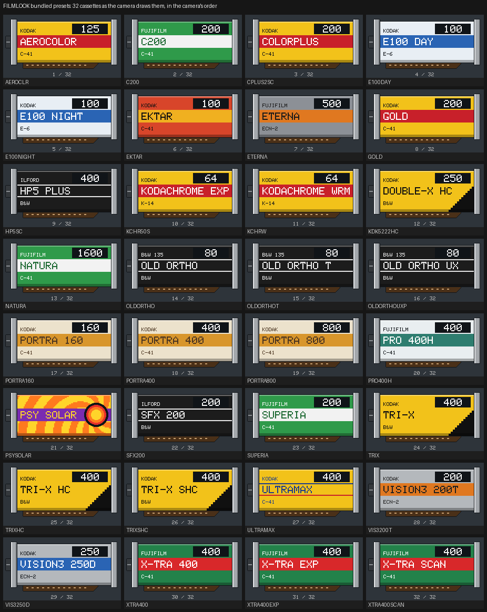

# FILMLOOK: the bundled presets

OMKit comes with a set of 32 FILMLOOK presets: `resources/modules/filmlook/presets/` in the source tree, `OMKIT\FILMLOOK\`
on a card made with `make -C OMKit card`. Each is an `.ISP` file ([../../formats/isp.md](../../formats/isp.md)) with the
colour tables of one look and a cassette picture for the camera's picture mode screen. How the module uses them:
[README.md](README.md).

## 1. What a preset is

| Part | What the camera does with it |
|---|---|
| profile name (the file's header) | shown in the logs and, without a cassette picture, in the look's item; written into the EXIF text with `exif = on` |
| `ISPB` - the colour tables | applied over Natural to live view and stills: a colour matrix, gamma curves, colour gains, a tone curve and 12 colour sectors |
| `CANI` - the cassette picture | drawn in the look's item with "n / N" under it |
| `META` - a few plain `key=value` lines | not read by the camera (the record of the tool that made the file) |

## 2. The set

In the camera's order (section 3). "B&W" in the last column follows the one rule of
[../../formats/isp.md section 5.1](../../formats/isp.md#51-black-and-white-blocks); a black-and-white preset never gets
colour grain. The character is what the profile name says (the film it is named after and the variant), not a
description of how the preset looks.

| # | File | Profile name | Cassette: brand | name line | ISO | process | Colour | Character (from the name) |
|---|---|---|---|---|---|---|---|---|
| 1 | `AEROCLR.ISP` | Kodak Aerocolor 125 | KODAK | AEROCOLOR | 125 | C-41 | colour | colour negative |
| 2 | `C200.ISP` | Fujifilm C200 | FUJIFILM | C200 | 200 | C-41 | colour | colour negative |
| 3 | `CPLUS2SC.ISP` | Kodak ColorPlus 200 | KODAK | COLORPLUS | 200 | C-41 | colour | colour negative |
| 4 | `E100DAY.ISP` | Kodak Ektachrome E100 Day | KODAK | E100 DAY | 100 | E-6 | colour | colour slide, variant Day |
| 5 | `E100NIGHT.ISP` | Kodak Ektachrome E100 Night | KODAK | E100 NIGHT | 100 | E-6 | colour | colour slide, variant Night |
| 6 | `EKTAR.ISP` | Kodak Ektar 100 | KODAK | EKTAR | 100 | C-41 | colour | colour negative |
| 7 | `ETERNA.ISP` | Fujifilm Eterna 500 | FUJIFILM | ETERNA | 500 | ECN-2 | colour | cinema colour negative |
| 8 | `GOLD.ISP` | Kodak Gold 200 | KODAK | GOLD | 200 | C-41 | colour | colour negative |
| 9 | `HP5SC.ISP` | Ilford HP5 Plus 400 | ILFORD | HP5 PLUS | 400 | B&W | B&W | black and white |
| 10 | `KCHR50S.ISP` | Kodak Kodachrome 64 Expired | KODAK | KODACHROME EXP | 64 | K-14 | colour | colour slide, variant Expired |
| 11 | `KCHRW.ISP` | Kodak Kodachrome 64 Warm | KODAK | KODACHROME WRM | 64 | K-14 | colour | colour slide, variant Warm |
| 12 | `KDK5222HC.ISP` | Kodak Double-X 5222 HC | KODAK | DOUBLE-X HC | 250 | B&W | B&W | black-and-white cinema film, variant HC |
| 13 | `NATURA.ISP` | Fujifilm Natura 1600 | FUJIFILM | NATURA | 1600 | C-41 | colour | colour negative |
| 14 | `OLDORTHO.ISP` | Old Ortho 80 | B&W 135 | OLD ORTHO | 80 | B&W | B&W | an old orthochromatic black and white, no one maker's film |
| 15 | `OLDORTHOT.ISP` | Old Ortho 80 Toned | B&W 135 | OLD ORTHO T | 80 | B&W | B&W | the same, variant Toned |
| 16 | `OLDORTHOUXP.ISP` | Old Ortho 80 Underexposed | B&W 135 | OLD ORTHO UX | 80 | B&W | B&W | the same, variant Underexposed |
| 17 | `PORTRA160.ISP` | Kodak Portra 160 | KODAK | PORTRA 160 | 160 | C-41 | colour | colour negative |
| 18 | `PORTRA400.ISP` | Kodak Portra 400 | KODAK | PORTRA 400 | 400 | C-41 | colour | colour negative |
| 19 | `PORTRA800.ISP` | Kodak Portra 800 | KODAK | PORTRA 800 | 800 | C-41 | colour | colour negative |
| 20 | `PRO400H.ISP` | Fujifilm Pro 400H | FUJIFILM | PRO 400H | 400 | C-41 | colour | colour negative |
| 21 | `PSYSOLAR.ISP` | Psychedelic Solarisation | - | PSY SOLAR | - | - | colour | a psychedelic solarised colour look, no one maker's film; its own cassette (a 1960s pop-art swirl) |
| 22 | `SFX200.ISP` | Ilford SFX 200 | ILFORD | SFX 200 | 200 | B&W | B&W | black and white |
| 23 | `SUPERIA.ISP` | Fujifilm Superia 200 | FUJIFILM | SUPERIA | 200 | C-41 | colour | colour negative |
| 24 | `TRIX.ISP` | Kodak Tri-X 400 | KODAK | TRI-X | 400 | B&W | B&W | black and white |
| 25 | `TRIXHC.ISP` | Kodak Tri-X 400 HC | KODAK | TRI-X HC | 400 | B&W | B&W | black and white, variant HC |
| 26 | `TRIXSHC.ISP` | Kodak Tri-X 400 SHC | KODAK | TRI-X SHC | 400 | B&W | B&W | black and white, variant SHC |
| 27 | `ULTRAMAX.ISP` | Kodak UltraMax 400 | KODAK | ULTRAMAX | 400 | C-41 | colour | colour negative |
| 28 | `VIS3200T.ISP` | Kodak Vision3 200T | KODAK | VISION3 200T | 200 | ECN-2 | colour | cinema colour negative, T (tungsten) stock |
| 29 | `VIS3250D.ISP` | Kodak Vision3 250D | KODAK | VISION3 250D | 250 | ECN-2 | colour | cinema colour negative, D (daylight) stock |
| 30 | `XTRA400.ISP` | Fujifilm X-Tra 400 | FUJIFILM | X-TRA 400 | 400 | C-41 | colour | colour negative |
| 31 | `XTRA400EXP.ISP` | Fujifilm X-Tra 400 Expired | FUJIFILM | X-TRA EXP | 400 | C-41 | colour | colour negative, variant Expired |
| 32 | `XTRA400SCAN.ISP` | Fujifilm X-Tra 400 Scan | FUJIFILM | X-TRA SCAN | 400 | C-41 | colour | colour negative, variant Scan |

23 colour and 9 black-and-white presets. The cassette pictures carry their lines in capitals; the name line is shown
here as it is drawn.



*The cassettes as the camera draws them, in the camera's order, with the file name under each.*

## 3. Order on the camera

FILMLOOK lists the presets in the order of their file names, without case: the order of the table above, which keeps the
variants of one film together (`E100DAY`, `E100NIGHT`; `OLDORTHO`, `OLDORTHOT`, `OLDORTHOUXP`; `TRIX`, `TRIXHC`,
`TRIXSHC`). Your own presets in the same folder fall into this order by their names. `presets =` in `[FILMLOOK]` gives an
order of its own, and only the files it names are shown ([README.md](README.md#5-settings)):

```ini
[FILMLOOK]
presets = PORTRA400, GOLD, TRIX, Kodak Portra 400 my edit
```

## 4. Naming rules of the set

The set follows the rules of [../../formats/isp.md section 7](../../formats/isp.md#7-the-bundled-preset-set); in short:

- **Profile name** - `Brand Film ISO [variant]`, in the maker's own spelling, no number repeated, no spaces at the ends.
  A look that is not one maker's film has no brand (`Old Ortho 80`).
- **Cassette** - the maker in capitals on the brand line (`B&W 135` when there is no maker), the film and its variant on
  the name line (at most 14 characters, so long variants are shortened: `KODACHROME EXP`, `X-TRA SCAN`), the speed in the
  ISO box and the process on the last line (`C-41`, `E-6`, `ECN-2`, `K-14`, `B&W`).
- **File name** - 8.3, chosen so that the order by name groups the variants of a film.

The same rules are a good start for presets of your own; the camera itself needs only a valid file.

## 5. Installing the set

| Way | What it does |
|---|---|
| `make -C OMKit card` | builds the card bundle; its `OMKIT/FILMLOOK/` holds the set (with `CORE.BIN`, the modules and the grain tiles) |
| `python3 OMKit/tools/presetset.py check [DIR]` | checks the set folder (default: the one in the source tree) against its `manifest.json`: every file's size and SHA-256, the file checks the camera makes, the profile name and the rules of `META`; a `.ISP` the manifest does not list is an error |
| `python3 OMKit/tools/presetset.py copy DEST [DIR]` | checks, then copies the set into `DEST` (for example the card's `OMKIT\FILMLOOK`) |
| by hand | copy the 32 `.ISP` files into `OMKIT\FILMLOOK\` on the card |

- **Your own presets are kept.** `presetset.py copy` and copying by hand only add or replace the set's files; other
  `.ISP` files in the folder stay. A file that an older set had under another name stays too: delete it by hand if it
  should go.
- **Replacing a preset drops its edits.** Edits made in the camera are kept per file name and file CRC: a new version of
  a file starts without edits ([README.md](README.md#6-what-is-kept-and-when-edits-are-dropped)). An unchanged file keeps
  them.
- At most 64 presets are shown: the set and your own together.

`manifest.json` lists, for every file: its name, profile name, size, SHA-256, the SHA-256 of its `ISPB` section, and the
brand, name and ISO texts of its cassette.
